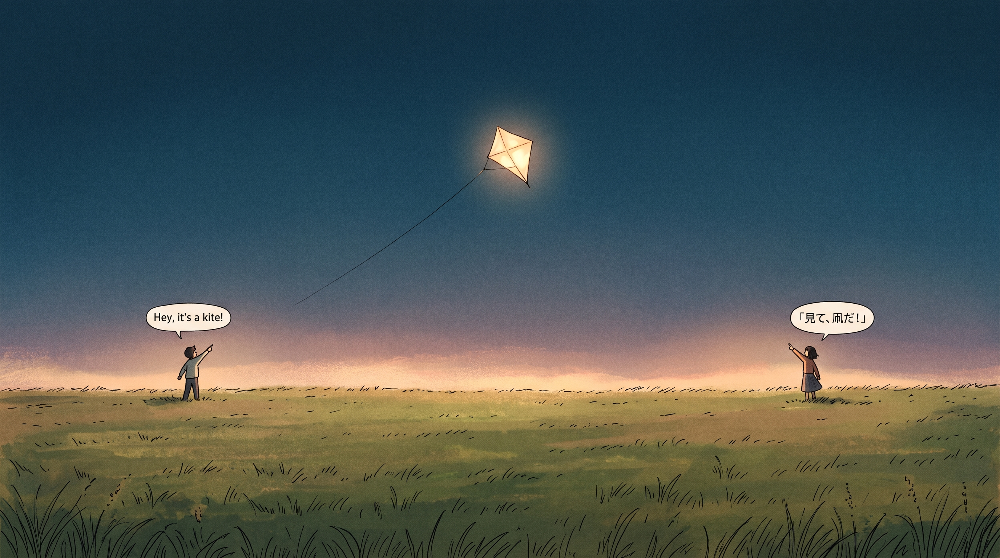
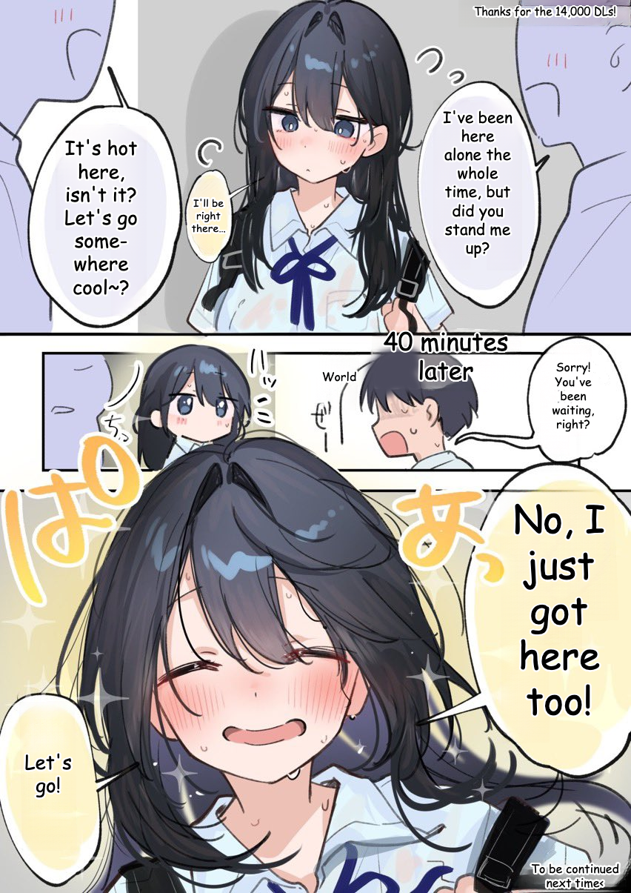
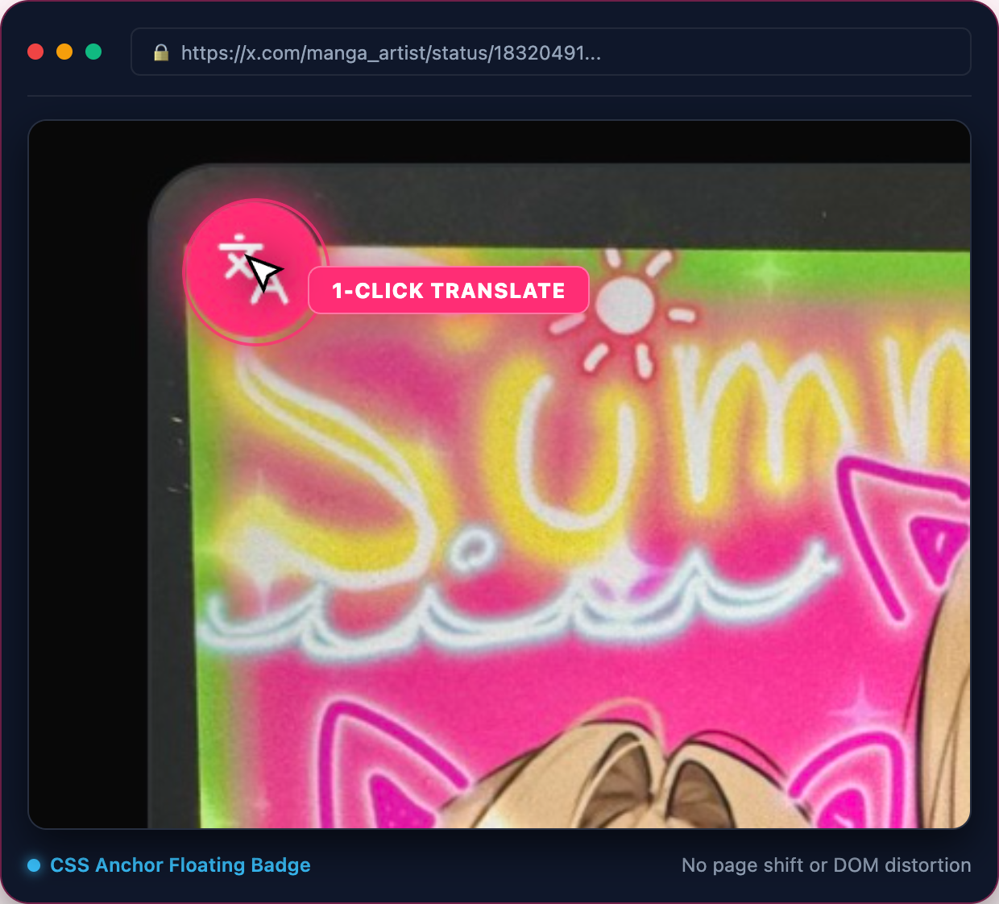
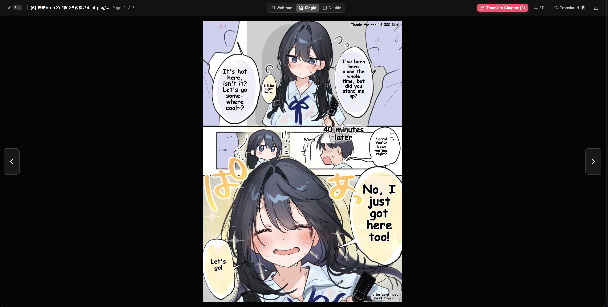
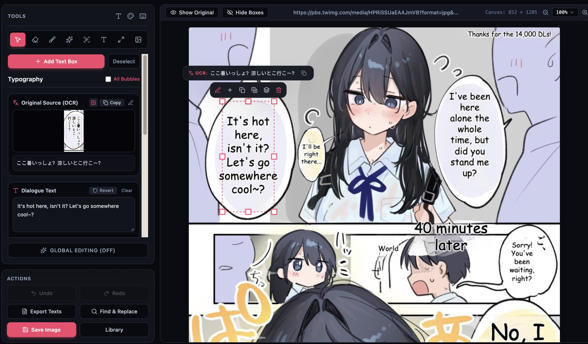
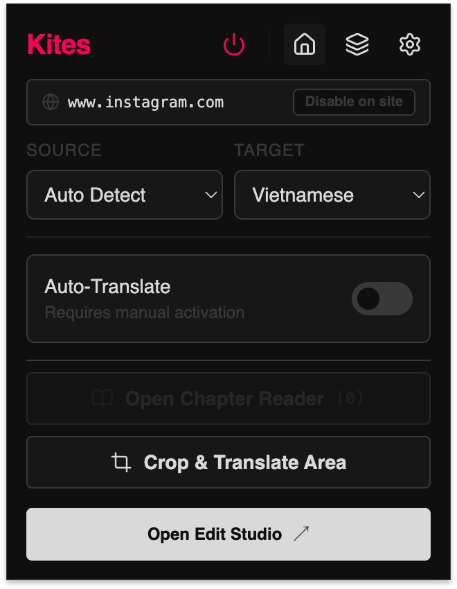
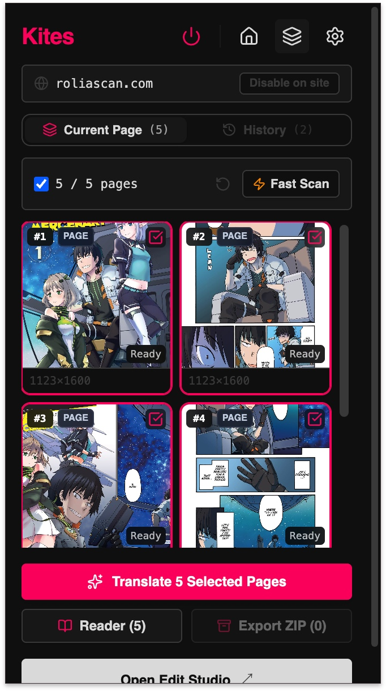
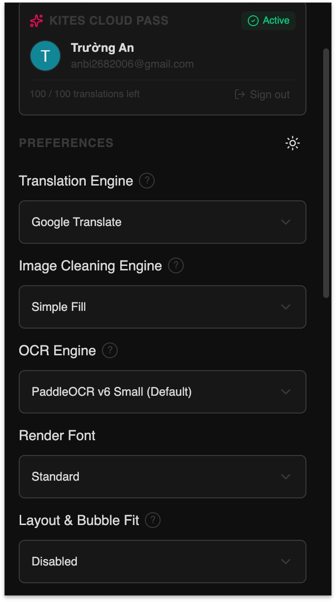

<div align="center">

[English](README.md) | [简体中文](README.zh-CN.md) | [Tiếng Việt](README.vi.md) | [日本語](README.ja.md)

# 🪁 Kites

### 在浏览器中直接阅读任意语言的漫画
**零 Python 环境 • 零外部服务器 • 100% 本地隐私的浏览器插件级 AI 漫画翻译**

[](https://chromewebstore.google.com/detail/pcaokchkdgnmfgjkljfpghlfohbdjcmj?utm_source=item-share-cb)
[](LICENSE)
[](manifest.json)
[](https://developer.mozilla.org/en-US/docs/Web/API/WebGPU_API)
[](package.json)

<br/>

<p align="center">
  <a href="https://chromewebstore.google.com/detail/pcaokchkdgnmfgjkljfpghlfohbdjcmj?utm_source=item-share-cb">
    
  </a>
  &nbsp;&nbsp;
  <a href="https://github.com/Unheat/Kites/releases/latest">
    
  </a>
</p>

<br/>

[](./README_images/Gemini_Generated_Image_f7lh52f7lh52f7lh.jpeg)

</div>

---

## 💡 为什么选择 Kites？

传统的漫画翻译工具往往需要安装复杂的 Python 运行环境、数以 GB 计的 CUDA 依赖包，或者需要将你的私人阅读记录上传到第三方云端服务器。

**Kites 彻底改变了这一切。** 它是一个轻量级的 Chrome 扩展插件，通过 **WebGPU 直接调用显卡算力**，在浏览器内部本地运行最前沿的视觉与大语言模型。

- ⚡ **零门槛开箱即用：** 在 [Chrome 网上应用店](https://chromewebstore.google.com/detail/pcaokchkdgnmfgjkljfpghlfohbdjcmj?utm_source=item-share-cb) 一键安装即可立即使用，无需终端命令行、无需 Python、无需配置任何依赖环境。
- 🔒 **100% 本地隐私安全：** 光学字符识别 (OCR) 与画面修图涂白完全在本地设备运行，你的漫画图片绝不会被上传到任何外部服务器。
- 🎨 **智能背景修复涂白：** 采用 AI Inpainting 图像修复算法，在干净擦除原文文字的同时，精准保留原始线稿、网点纸质感与背景纹理。
- ✍️ **自然排版嵌字：** 自动测量对话气泡框尺寸、智能平衡断行与换行、自适应字体大小与字号，并动态适配文字与描边颜色。
- 🗨️ **智能气泡贴合与切除：** 搭载先进的气泡检测算法（启发式 Heuristic 与神经 YOLO），将原本狭长的 CJK 竖排文本框智能扩展到宽敞的气泡内部空间，彻底告别挤压缩小的蚂蚁字。
- 📜 **全长条 Webtoon 卷轴支持：** 原生支持超长条漫（$>14,000\text{ px}$），采用 1D 内存 Canvas 分块切片技术，以原生原始分辨率流畅翻译。
- 🛠️ **内置专业工作室 (Studio)：** 在线即时修正翻译文本、手动调整文字气泡框位置与大小，或微调排版样式。

---

## 🖼️ 效果展示

### 全页翻译 + 上色 (中文 → 英文)
> *原始灰度中文页与完整翻译、上色后的英文结果对比，气泡贴合自然。*

<div align="center">
<table>
  <tr>
    <th width="50%" align="center">原始中文页 (Original Chinese)</th>
    <th width="50%" align="center">Kites 翻译 + 上色 (Translated + Colorized)</th>
  </tr>
  <tr>
    <td align="center">
      
    </td>
    <td align="center">
      
    </td>
  </tr>
</table>
</div>

### 日文 → 英文 (Japanese → English)
> *作品: 佐藤さんは知っていた by [@09ra_19ra](https://x.com/09ra_19ra)*

<div align="center">
<table>
  <tr>
    <th width="50%" align="center">原始日文 (Original Japanese)</th>
    <th width="50%" align="center">Kites 翻译效果 (Kites Translated)</th>
  </tr>
  <tr>
    <td align="center">
      
    </td>
    <td align="center">
      
    </td>
  </tr>
</table>
</div>

### 日文 → 越南文 (Japanese → Vietnamese)
> *出处: [Pixiv Artwork #145272482](https://www.pixiv.net/en/artworks/145272482)*

<div align="center">
<table>
  <tr>
    <th width="50%" align="center">原始日文 (Original Japanese)</th>
    <th width="50%" align="center">Kites 翻译效果 (Kites Translated)</th>
  </tr>
  <tr>
    <td align="center">
      
    </td>
    <td align="center">
      
    </td>
  </tr>
</table>
</div>

---

## 🖱️ 即时就地翻译

在 Twitter/X、Pixiv 或各大漫画网站上浏览漫画时，只需将鼠标悬停在任意分镜图上，就会出现一个轻量悬浮翻译按钮（基于 CSS Anchor 定位技术）—— 点击即可直接在原图画面上就地替换翻译文本，无需任何复制粘贴。

<div align="center">
  
</div>

- 🖱️ **悬停翻译 (Hover)：** 鼠标悬停任意分镜或漫画插图即可一键即时翻译。
- 📌 **常驻模式 (Persistent)：** 让翻译徽标常驻显示在页面中的所有漫画图片上。
- 🚀 **自动翻译 (Auto-Translate)：** 随着页面向下滚动，自动检测并翻译视野中新加载的漫画分镜。
- ✂️ **屏幕截屏选区翻译 (Screen Crop)：** 通过右键菜单或快捷键 `Ctrl/Alt + Shift + X`，自由截屏框选翻译受保护的 Canvas 画布、WebGL 网页游戏或任意局部画面。
- ⚡ **阅读快捷键：** 按 `F` 键瞬间对比/偷看原始生肉画面；按 `Ctrl/Alt + Shift + Z` 立即翻译当前鼠标悬停的图片；按 `Ctrl/Alt + Shift + M` 快速打开章节阅读器。
- 🎯 **右键菜单翻译：** 通过浏览器右键上下文菜单，随时翻译网络上的任意图像。

---

## 📖 章节阅读器与极速扫描

在一个专注无干扰的独立视图中阅读整话漫画或 Webtoon：支持自动批量扫描、无缝垂直滚动漫条模式、多页并行翻译与离线 ZIP 归档导出：

[](./README_images/UI-feature/reader.png)

- **极速扫描 (Fast Scan)：** 自动向下滚动页面并捕获章节中所有懒加载的漫画分镜，智能加入排队队列。
- **灵活阅读模式：** 自由切换 Webtoon 连续垂直长条卷轴、单页模式与双页对开展开布局。
- **整话批量翻译：** 一键翻译整话漫画，配备实时进度追踪与离线缓存保留机制。
- **一键打包 ZIP 导出：** 将整话翻译完成的页面按序号打包为结构清晰的 ZIP 压缩包，完全在本地处理，便于离线保存与归档，零服务器上传风险。

---

## 🛠️ 内置 Kites Studio 工作室

想要校对润色熟肉译文，或者微调排版效果？可直接从插件一键启动全屏 **Kites Studio** 嵌字修图工作台。

[](./README_images/UI-feature/studio-editor.png)

- **直接行内双击编辑：** 双击任意文本气泡即可在原位置直接修改译文内容，支持亚像素垂直居中与实时排版重排。
- **交互式气泡画布：** 支持 8 点缩放控制手柄，自由拖拽移动或调整对话气泡大小。
- **局部 AI 修复画笔 (Inpaint Brush)：** 像素级画笔精准涂白擦除画面瑕疵、对话气泡或未被翻译的拟声词 (SFX)。
- **多视图实时对比：** 一键在生肉原图、涂白修图层与排版嵌字层之间无缝切换比对。
- **精细排版控制：** 实时调整字体字号、文字颜色、对齐方式、描边效果与行高间距。
- **一键原图导出：** 以原始无损分辨率导出干净的翻译成品图像。

---

## 🎛️ 插件控制与预设设置

通过简洁优雅的弹出面板自定义目标语言、神经网络 OCR 模型以及背景修复算法：

<div align="center">
<table>
  <tr>
    <th width="33%" align="center">快捷控制面板 (Quick Control)</th>
    <th width="33%" align="center">章节阅读与扫描 (Reader &amp; Scanner)</th>
    <th width="34%" align="center">引擎与算法设置 (Engine Settings)</th>
  </tr>
  <tr>
    <td align="center">
      
    </td>
    <td align="center">
      
    </td>
    <td align="center">
      
    </td>
  </tr>
</table>
</div>

- **自定义术语表 (Custom Glossary)：** 预设角色姓名、专属称谓与专业术语，精准引导本地与云端 LLM 的翻译用词。
- **站点域名规则：** 针对特定网站域名自定义元素选择器，或单独启用/禁用翻译功能。

---

## 🧠 现代 AI 技术驱动

| 核心模块 | 可选方案 | 详细描述 |
| :--- | :--- | :--- |
| **翻译引擎 (Translation)** | **WebLLM** *(本地 WebGPU)*<br/>**云端共享公共池** *(每日100次免费)*<br/>**Google 翻译** *(完全免费且不限次)*<br/>**自定义 API** *(OpenAI, Claude, Gemini)* | 在浏览器中直接运行无限制的本地端侧 LLM（Qwen 3.5, Qwen 3, Gemma 3, Llama 3.2），畅享不限次数的 Google 翻译，使用免费社区公共池（每日100次配额），或接入你自己的 API 密钥。 |
| **图像修复 (Inpainting)** | **LaMa Manga** *(神经修复)*<br/>**AOT-GAN** *(超快神经模型)*<br/>**Telea Diffusion** *(即时传统算法)*<br/>**简单背景填充 (Simple Fill)** | 严格在文字边缘轮廓内擦除原文，最大程度保留原本线稿与网点质感。 |
| **文字识别 (OCR)** | **PaddleOCR v3 – v6** | 行业标杆级多语言文字检测与识别，无缝支持超长条漫 1D 切片流式拼接。 |
| **气泡贴合 (Bubble Fit)** | **Neural YOLO** *(WebGPU)*<br/>**启发式 (Heuristic)** *(极速)*<br/>**经典 MST** | 自动切除气泡小尾巴，将文字舒展贴合至自然圆形气泡留白区域，彻底告别文字挤压。 |

---

## 🚀 快速上手与安装

### 方式 1: Chrome 网上应用店（推荐 • 一键安装）

官方最简便的安装途径，包含自动后台静默更新与 Google 官方安全审核：

<div align="left">
  <a href="https://chromewebstore.google.com/detail/pcaokchkdgnmfgjkljfpghlfohbdjcmj?utm_source=item-share-cb">
    
  </a>
</div>

1. 打开 **[Chrome 网上应用店中的 Kites 页面](https://chromewebstore.google.com/detail/pcaokchkdgnmfgjkljfpghlfohbdjcmj?utm_source=item-share-cb)**。
2. 点击 **添加至 Chrome** 并确认安装权限提示。
3. 将 **Kites** 固定在浏览器工具栏以便随时使用。
4. 打开任意漫画或插画页面（如 Twitter/X、Pixiv、MangaDex 等），将鼠标悬停在漫画分镜上即可开始翻译！

---

### 方式 2: 预编译 Release 压缩包（手动解压加载 — 无需终端）

适用于离线环境、手动测试或加载特定发布版本：

1. 从最新 GitHub Release 下载 **[`kites.zip`](https://github.com/Unheat/Kites/releases/latest)**。
2. 将下载的 `.zip` 文件解压到电脑中的任意文件夹。
3. 在 Chrome 浏览器地址栏中输入并打开 `chrome://extensions/`。
4. 在右上角开启 **开发者模式 (Developer mode)** 开关。
5. 点击左上角的 **加载已解压的扩展程序 (Load unpacked)** 并选择刚刚解压的文件夹。
6. 将 **Kites** 固定到浏览器工具栏，即可立即畅享阅读！

---

### 方式 3: 源码构建（面向开发者）

```bash
# 1. 克隆代码仓库
git clone https://github.com/Unheat/Kites.git
cd Kites

# 2. 安装依赖并构建扩展
npm ci
npm run build
```

1. 在 Chrome 中打开 `chrome://extensions/`。
2. 开启右上角的 **开发者模式** 开关。
3. 点击 **加载已解压的扩展程序** 并选择项目生成的 `dist/` 目录。
4. 将 **Kites** 固定至工具栏，即可开始调试与阅读！

---

## 🤝 参与贡献与开发文档

我们热烈欢迎开发者、翻译人员和漫画爱好者的积极参与和贡献！

- 📖 **[开发文档中心](docs/README.md)** — 架构图解、处理管线规范与运行时契约。
- 📐 **[交互式管线流程图](docs/workflow.html)** — 独立交互式网页，直观展示 Kites 的文本检测、背景修图与排版算法全流程。
- 🛠️ **[贡献指南](CONTRIBUTING.md)** — 如何搭建本地开发环境、运行测试用例及提交 PR。

---

## 📜 开源许可与致谢

Kites 遵循 **[GNU General Public License v3.0](LICENSE)** 开源协议。

衷心感谢以下为 Kites 提供核心启发与算法支撑的卓越开源项目：
- **[manga-image-translator (Cotrans)](https://github.com/zyddnys/manga-image-translator):** 奠基性的空间文本分组与排版渲染算法。
- **[xianscan-rust](https://github.com/ArbenApura/xianscan-rust):** 动态补丁修复架构与 OCR 噪点过滤算法。
- **[koharu](https://github.com/koharu-rs/koharu):** 轮廓排版核心 — 1:1 移植的 DP 断行、轮廓字号搜索与连字符回退。
- **[PaddleOCR](https://github.com/PaddlePaddle/PaddleOCR):** 高性能端到端多语言神经网络文字检测与识别模型。
- **[@mlc-ai/web-llm](https://github.com/mlc-ai/web-llm):** 浏览器原生 WebGPU 大语言模型推理运行时。
- **[pyheal](https://github.com/olvb/pyheal) & [OpenCV](https://github.com/opencv/opencv):** Telea 快速行进法（FMM）修复算法的 TypeScript 移植来源。
- **[InpaintWeb](https://github.com/lxfater/inpaint-web):** 浏览器端 LaMa 修复架构参考。
- **[hypher](https://github.com/typst/hypher) & [linebreak](https://github.com/devongovett/linebreaker):** 按需 Liang 连字符模式库与 UAX #14 断行机会。
- **[CRXJS (chrome-extension-tools)](https://github.com/crxjs/chrome-extension-tools):** 构建工具链所用的 Manifest V3 Vite 插件。
- **MTO Comic Fonts:** 字体库内置的越南语 scanlation 优化社区字体。

完整许可证文本、锁定版本与移植功能明细：[THIRD_PARTY_NOTICES.md](THIRD_PARTY_NOTICES.md)。

---

<div align="center">
  <sub>专为漫画与条漫爱好者打造，用 ❤️ 呈现。如果 Kites 让你享受到了流畅阅读的乐趣，欢迎在 GitHub 点个 ⭐ Star 支持！</sub>
</div>
