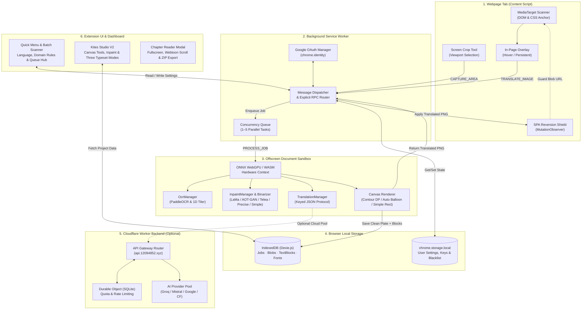

# System Architecture Overview 🏛️

Kites is built as a **Chrome Manifest V3 (MV3)** extension designed to process and translate comic images with spatial awareness while keeping computation local, private, and fast.

This document outlines the multi-tier extension architecture, runtime boundaries, communication contracts, storage schema, and supporting backend services.

**Current-code audit (2026-10-28):** cumulative `origin/main..main` through `656d720`; current typesetting/storage notes supersede the former dual-mode summary. Shared algorithms and visual test runners are not evidence of end-to-end pixel parity.

---

## 🏗️ Architectural Topology

Chrome Manifest V3 enforces strict security boundaries: service workers are ephemeral, background contexts cannot access DOM or WebGPU adapters reliably, and page scripts cannot execute untrusted code.

Kites overcomes these constraints using a coordinated six-part architecture:

---

## 🧩 Core Subsystems & Runtime Contracts

### 1. Webpage Content Script (`src/content/`)
- **Universal Media Discovery (`MediaTarget`):** Scans the DOM for comic panels (minimum dimension `150 × 150 px`). Resolves complex layout wrappers:
  - Invisible backing `` layers beneath pointer overlays (Twitter/X, Pixiv).
  - SVG placeholder handling: Detects and skips inline data-URL SVG placeholders without wedging queues.
  - CSS `background-image` extraction on div-based readers.
- **CSS Anchor Positioning & Hover Halo:** Floats translation action buttons directly over comic panels using modern CSS Anchor Positioning with a 3px boundary halo to prevent pointer flicker.
- **Single-Page Application (SPA) Reversion Shield:** Modern reactive SPAs (React Native for Web, Vue) re-render and wipe mutated `src` attributes. Kites mounts a targeted `MutationObserver` (`attachReversionShield`):
  - Clears `srcset` attributes to prevent responsive image resets.
  - Converts large Base64 strings to same-origin Blob URLs (`URL.createObjectURL(blob)`) to avoid DOM bloat and CSP rejections.
  - Intercepts SPA re-renders and re-applies the translated image.
- **Screen Crop Translation (`ScreenCropManager`):** For protected canvas elements, WebGL viewers, or complex panels, users can draw a screen-pinned crop box (Xnip-style `position: fixed` viewport overlay) to translate arbitrary screen areas.
- **Distraction-Free Chapter Reader Modal (`ChapterReaderModal.tsx`):** Provides fullscreen reading with webtoon vertical scroll and double-page spreads, live streaming page updates, canonical chapter scope resolution (`getChapterScopeId`), and ordered ZIP export bounded by a 128 MiB session budget.
- **Reading Shortcuts:** Built-in `Alt+Shift+Z` (translate), `Alt+Shift+X` (screen crop), and `F` (peek original) hotkeys with cross-platform keydown fallbacks.

👉 *Detailed guide: [`docs/architecture/content-script-and-media.md`](content-script-and-media.md)*

---

### 2. Background Service Worker (`src/background/`)
- **Ephemeral Event Hub:** Mediates all messaging between content scripts, the popup UI, and the offscreen document.
- **Job Deduplication & Concurrency Queue:** Manages translation tasks, deduplicates redundant requests on the same image, and enforces configurable concurrency (1 to 5 jobs).
- **Explicit RPC Routing Contract:** Chromium broadcasts extension messages to all active contexts. To prevent cross-talk and ghost execution, every message carries explicit routing markers:
  - `target: 'background' | 'offscreen'`
  - `source: 'popup' | 'content' | 'background' | 'offscreen'`
  - `request: true`
- **Google OAuth Manager (`src/background/auth/`):** Manages `chrome.identity.getAuthToken` flows for users connecting to the Cloudflare Shared Pool.

---

### 3. Offscreen Document Sandbox (`src/offscreen/`)
- **Why Offscreen?** Manifest V3 terminates service workers after 30 seconds of inactivity or long compute runs. Neural models (ONNX WebGPU shaders, LaMa inpainting, WebLLM generation) require an un-throttled environment with DOM and GPU access. The Offscreen Document provides a persistent DOM context.
- **Hardware Acceleration (`hardware.ts`):** Probes WebGPU capability with high-performance adapter preference. Seamlessly falls back to WebAssembly (WASM SIMD) if WebGPU is unavailable or encounters driver errors.
- **Pipeline Orchestrator (`PipelineOrchestrator.ts`):** Controls the end-to-end pipeline:
  1. OCR via `OcrManager` (with 1D tiling for $h \ge 2500\text{ px}$ images).
  2. 14-stage geometric and noise filtering + Kruskal MST bubble clustering.
  3. Network translation overlaps vision work. Local WebLLM translation, colorization, and inpainting run sequentially to avoid competing WebGPU workloads.
  4. Bubble geometry acquisition/resolution (`off`, `heuristic`, `neural`), followed by strategy dispatch (Contour DP, Simple Rect, Auto Balloon); non-Western targets retain a legacy orientation-aware drawing route.
  5. Affine matrix canvas baking.

👉 *Detailed guide: [`docs/architecture/pipeline.md`](pipeline.md)*

---

### 4. Local Database & Clean Plate Storage (`src/db.ts`)
- **Dexie.js on IndexedDB:** Persists full translation records locally on the user's device.
- **Clean Plate Storage Invariant:** Rather than destructively baking translated text into the stored database image, Kites saves the **raw inpainted background plate** alongside structured `TextBlock[]` arrays (coordinates, original text, translated text, font size, color, stroke).
- **Retention Cleanup:** Startup recovery/cleanup applies retention to eligible unprojected terminal jobs. Jobs with `folderId` are protected from age-based retention cleanup; project deletion remains explicit.
- **Schema v6 Fonts:** `fonts` stores catalog/import bytes and family metadata; contour/positioned-line fields are persisted on text blocks. Original detection baselines are not persisted. See [Studio lifecycle](studio-and-typesetting.md#bubble-geometry-database--studio-lifecycle).

---

### 5. Cloudflare Zero-Cost Worker Backend (`worker/`)
- **API Gateway (`api.12094852.xyz`):** An edge-hosted translation proxy enabling shared community AI access without requiring users to purchase API keys.
- **Durable Objects with SQLite:** Enforces daily user quotas (e.g. 50 pages/day) and sliding-window rate limits per Google account.
- **Resilient Multi-Provider Waterfall:**
  $$\text{Groq} \longrightarrow \text{Mistral} \longrightarrow \text{Google AI Studio} \longrightarrow \text{Cloudflare Workers AI}$$
  If one provider experiences downtime or rate limits (HTTP 429), the Worker automatically cascades to the next provider within milliseconds.

👉 *Detailed guide: [`docs/architecture/backend-worker.md`](backend-worker.md)*

---

### 6. Kites Studio & Typesetting Editor (`src/studio/Studio.tsx`, hosted by `src/App.tsx`)
- A full-screen desktop dashboard built with React 19 and Tailwind CSS 4.
- **Interactive 8-Point Bounding Boxes & Gesture State Machine:** 3px drag deadzone, RAF-throttled reflow, decoupled double-click editing, and clamped handle hit radii.
- **Three Typesetting Choices:** Contour, Auto Balloon and Caption Box. Backend contour-priority routing differs from Studio explicit edit branches; Caption Box edits retain current size. Canvas `TextRenderer` paints text, not SVG.
- **Font Library:** Bundled comic faces plus an on-demand catalog/import library, searchable pickers, per-document FontFace registration and explicit selected-family loading for the live bake.
- **Current Caveats:** Stored raw contours may outlive rejected bubble layouts; furniture visibility does not prove solver use. Reset restores transient frame dimensions/contour, not position/rotation. Current 18/20/24 contour caps are customization, not donor parity.
- **Advanced Lettering Tools:** Rotation angle slider with curved handle & snapping, partial word selection styling, and stroke-then-fill canvas layering.
- **3-Way View Switcher & Universal Brushes:** Quick toggles between Original, Inpainted, and Typeset canvases with direct AI brush inpainting.
- **Lossless PNG/JPEG & Clipboard Export:** Exports high-resolution 1:1 comic pages with canvas untaint guards.

👉 *Detailed guide: [`docs/architecture/studio-and-typesetting.md`](studio-and-typesetting.md)*

---

## 🔒 Security & Privacy Architecture

- **100% Local Inference Option:** When using WebLLM and local inpainting, no image or text data leaves the user's browser.
- **Zero Image Uploads to Cloud:** Even when using cloud translation, only plain extracted text strings are sent to the translation API — image blobs are never transmitted externally.
- **Encrypted Local Storage:** User API keys (OpenAI, Anthropic, Gemini) are stored in `chrome.storage.local` and never synced across devices.
- **Strict Content Security Policy (CSP):** `manifest.json` specifies `"script-src 'self' 'wasm-unsafe-eval'; object-src 'self'"`. No external CDN scripts or remote code execution are permitted.
