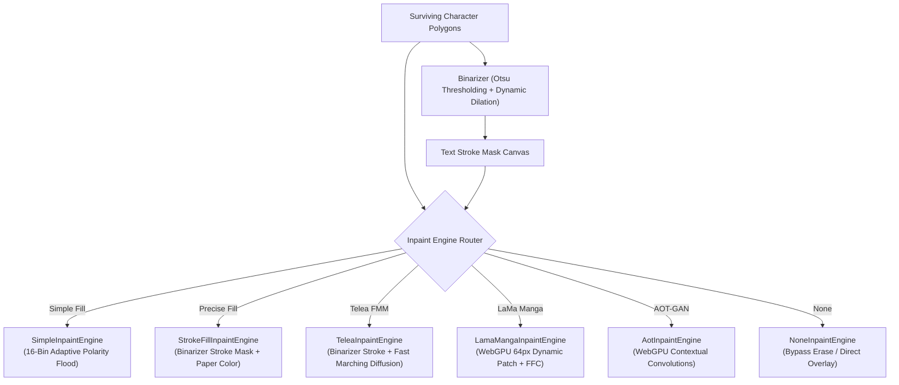
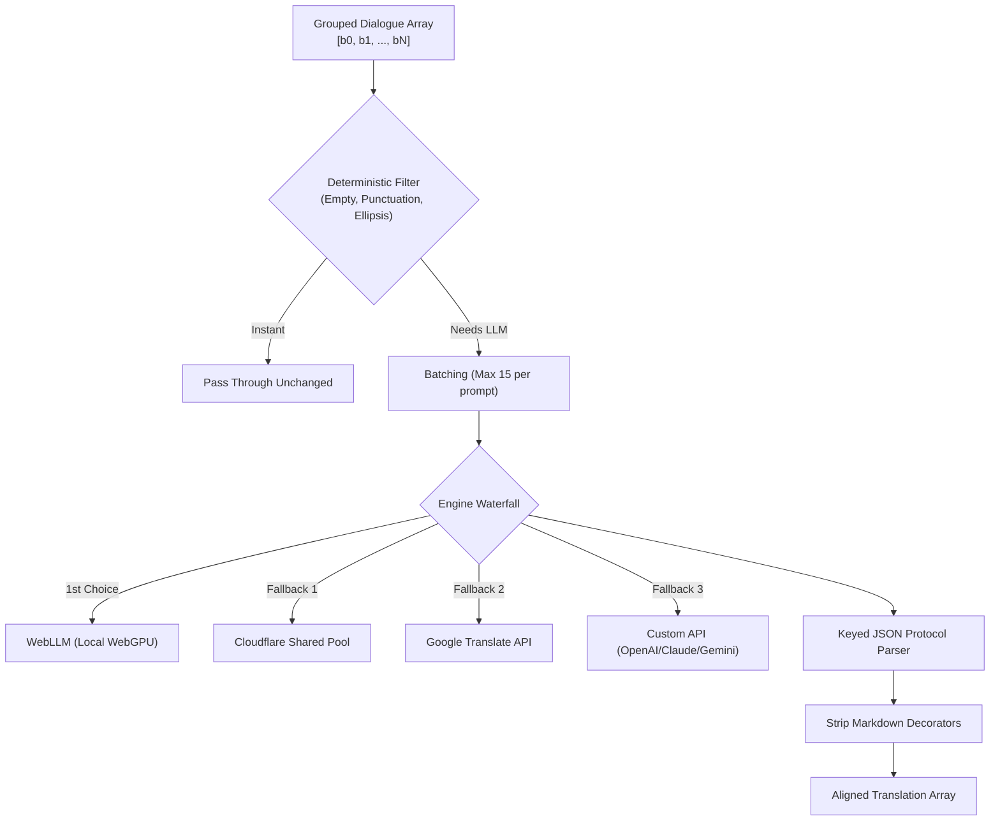
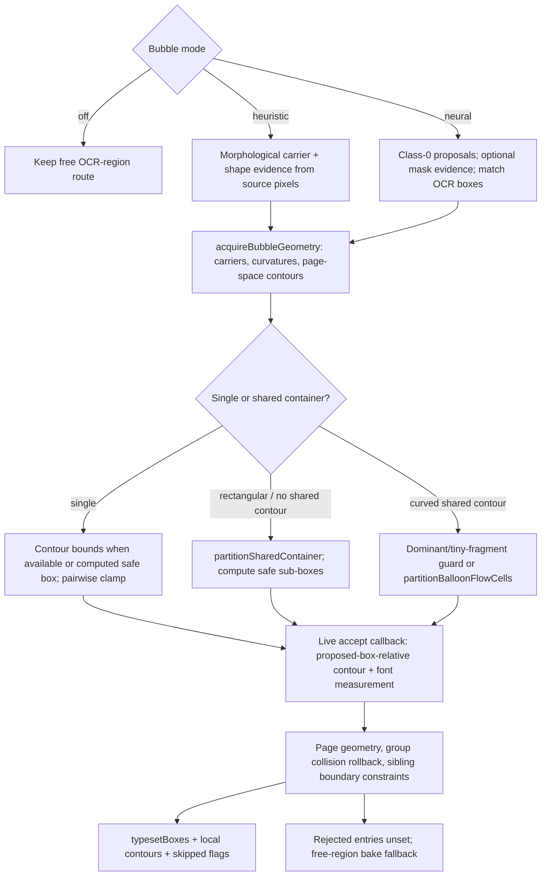

# Translation Pipeline & Algorithm Guide 📐

This document describes Kites' spatial comic translation pipeline. **Current-code audit: 2026-10-28, cumulative `origin/main..main` through `656d720`.** The numbered overview groups work into five stages; the detailed sections separate bubble resolution from drawing. Current route-specific behavior below supersedes older universal ellipse/four-pass descriptions; no end-to-end pixel parity is implied.

> 💡 **Want to explore interactively?** Open [`docs/workflow.html`](../workflow.html) for an explorable architecture diagram with inspectable parameters and formula cards.

---

## 🔄 The 5-Stage Processing Pipeline

```mermaid
flowchart LR
    classDef stage fill:#1e293b,stroke:#38bdf8,stroke-width:2px,color:#fff;
    classDef branch fill:#1e293b,stroke:#a855f7,stroke-width:2px,color:#fff;
    classDef out fill:#1e293b,stroke:#10b981,stroke-width:2px,color:#fff;

    subgraph S1["Stage 1: Detection & OCR"]
        Tiling["1D Vertical Tiler<br/>(h ≥ 2500px, 1000/700/300)"]:::stage
        DBNet["PP-OCR DBNet<br/>(4-Point Polygons)"]:::stage
        WarpRec["Projective Crop &<br/>Text Recognition"]:::stage
    end

    subgraph S2["Stage 2: Filter & Grouping"]
        Noise14["14-Stage Geometric &<br/>Text Noise Filter"]:::stage
        KruskalMST["Kruskal MST<br/>Speech Bubble Clustering"]:::stage
        ReadingOrder["Language-Aware<br/>Panel Reading Order"]:::stage
    end

    subgraph S3["Stage 3 & 4: Parallel Compute"]
        direction TB
        InpaintBranch["Stage 3: Polygon Inpainting<br/>(LaMa 64px / AOT-GAN / Simple Hist)"]:::branch
        TransBranch["Stage 4: Translation Waterfall<br/>(Keyed JSON: WebLLM / Cloud / Google)"]:::branch
    end

    subgraph S5["Stage 5: Typesetting & Render"]
        ColorSample["Per-Block Color Detection<br/>(Clustering / Contrast Fallback)"]:::out
        BinaryFit["Bubble Layout + Strategy Resolution<br/>Contour DP / Simple Rect / Auto Balloon"]:::out
        MatrixBake["Affine Canvas Matrix<br/>& Final Plate Export"]:::out
    end

    Tiling --> DBNet
    DBNet --> WarpRec
    WarpRec --> Noise14
    Noise14 --> KruskalMST
    KruskalMST --> ReadingOrder
    ReadingOrder -->|Surviving Polygons| InpaintBranch
    ReadingOrder -->|Grouped Text Blocks| TransBranch
    InpaintBranch --> ColorSample
    TransBranch --> ColorSample
    ColorSample --> BinaryFit
    BinaryFit --> MatrixBake
```



---

## 🔍 Detailed Algorithmic Breakdown

### Stage 1: Text Detection & Recognition (`OcrManager.ts` & `PaddleOcrEngine.ts`)

#### 1. Automatic 1D Vertical Tiling for Tall Webtoons
Modern webtoons (Naver, Kakao, Webtoon, Bilibili) are rendered as tall stitched image strips often reaching 10,000–30,000 pixels in height. Processing these full-canvas causes GPU memory crashes or squashes aspect ratios into illegibility.

When an image height exceeds `2500 px` ($H \ge 2500$), Kites activates **1D in-memory canvas tiling**:
- **Tile Dimensions:** Sliding window of height $H_{\text{tile}} = 1000\text{ px}$ with step size $S = 700\text{ px}$, creating an overlap zone of $300\text{ px}$.
- **Local OCR Inference:** Each slice is cropped onto a reusable offscreen canvas and recognized independently.
- **Coordinate Re-projection:** Polygon coordinates $(x, y)$ are projected back to full-page coordinates by adding the tile's vertical offset $Y_{\text{offset}}$.
- **IoU Boundary Deduplication:** Polygons in the overlap zone are matched using Intersection-over-Union ($\text{IoU} \ge 0.40$). The instance with higher recognition confidence is retained.

#### 2. DBNet Text Detection
- **Dynamic Dimension Scaling:** Slices are normalized with maximum dimension clamped to $960\text{ px}$ while preserving aspect ratio.
- **Probability Map & Binarization:** DBNet produces an approximate segmentation map. Pixels with probability $\ge 0.3$ are binarized.
- **Polygon Extraction (`dt_polys`):** Connected components with contour area $\ge 15\text{ px}^2$ are extracted as convex hull quadrilaterals.
- **Unclipping:** Contours are expanded using the Vatti polygon clipping algorithm with:
  $$\text{Distance} = \frac{\text{Area} \times (1 - r^2)}{\text{Perimeter}}, \quad r = 1.5$$

#### 3. Projective Homography & CTC Recognition
- **Bicubic Perspective Warp:** Rotated text bounding boxes $[p_0, p_1, p_2, p_3]$ are projectively warped to standard horizontal rectangular matrices.
- **Vertical Text Strip Detection:** For vertical scripts ($\text{height} / \text{width} \ge 1.5$), crops are rotated $90^\circ$ counter-clockwise.
- **CTC Beam Search Decoding:** Recurrent SVTR/CRNN networks decode character indices using language-specific dictionaries (`ppocrv6_dict.txt`, `japan_dict.txt`, etc.).

---

### Stage 2: Geometric Filtering & Kruskal-MST Grouping (`OcrManager.ts` & `textCleaning.ts`)

Raw OCR detection contains noise from artwork cross-hatching, screentones, watermark URLs, and sound effects. Kites runs a multi-stage filtering and grouping pipeline ported from Cotrans and XianScan.

#### 1. The 14-Stage Noise Filtering Battery
1. **Micro-Box Rejection:** Drops boxes with width or height $< 10\text{ px}$ unless high-confidence dialogue.
2. **Page-Spanning Artifact Rejection:** Eliminates boxes spanning $\ge 60\%$ of total page width and $\ge 120\text{ px}$ height (borders, frames, panels).
3. **Extreme Tilt Filter:** Drops boxes rotated beyond $12^\circ$ unless tagged as intentional angled speech.
4. **Margin Sliver Filter:** Drops slivers adhering strictly to the canvas boundary ($\le 5\text{ px}$ from page edge).
5. **Thought-Bubble Tail Filter:** Rejects repeating circles (`0oO○●⊙◯`) generated by OCR attempting to read bubble tails.
6. **Pure Punctuation & Dots:** Strips isolated ellipsis and particle rows (`...`, `---`, `‥`).
7. **Standalone Digit Noise:** Rejects random isolated numbers that fail dialogue plausibility checks.
8. **Scanlator Watermarks:** Regex filtering for scanning groups, release URLs, Discord links, and scanlation credit signatures (`colamanga`, `baozimh`, `bilibili`, `discord.gg`, `patreon`).
9. **Trailing Watermark Debris Stripping:** Strips scanlation website suffixes appended to dialogue lines (e.g. `别吵！colamanga.com` $\to$ `别吵！`) and rescales polygon bounds proportionally.
10. **Speedline & Action Stroke Filter:** Eliminates single-stroke CJK radicals and line art misidentified as text (`一`, `丨`, `丶`, `─`, `│`, `|`, `二`).
11. **Furigana Reading Aid Suppression:** Suppresses ruby/furigana characters running parallel to main dialogue lines where font size is $< 0.45\times$ of the parent text.
12. **Duplicate & Containment Deduplication:** When two detections have $\ge 50\%$ bounding box overlap, preserves the longer text slice or higher confidence read.
13. **Low-Confidence Standalone Latin Filter:** In CJK pages, purges stray isolated Latin noise strings below confidence thresholds while preserving genuine English loanwords.
14. **Action SFX Exemption:** Protects genuine onomatopoeia and shouts (`哒嗒啪轰`, `쾅쿵`, `ah`, `boom`) from being misfiltered by short-line rules.

#### 2. Spatial Bubble Clustering (Kruskal Minimum Spanning Tree)
Multiple lines in a single speech bubble must be grouped into one coherent text region:
- **Direction Determination:** Evaluates line aspect ratio and structure midpoints to determine horizontal (`h`) vs vertical (`v`) direction.
- **Proximity Graph:** Evaluates spatial distance between line boundaries using Cotrans `quadrilateral_can_merge_region`:
  - Font size ratio tolerance: $\le 2.0$
  - Aspect ratio tolerance: $\le 1.3$
  - Character gap tolerance: $1.0\times$ font size along text flow, $3.0\times$ perpendicular.
- **Kruskal MST Splitting:** For candidate graph components, builds a Minimum Spanning Tree over line centroids. Slices edges exceeding standard deviation bounds:
  $$\text{weight}_{\max} > \mu + 2\sigma \quad \text{and} \quad \text{weight}_{\max} > 1.5 \times \text{fontSize}$$
- **Intra-Bubble Line Ordering:**
  - Horizontal bubbles (`h`): Centroid $Y$ ascending (top-to-bottom).
  - Vertical bubbles (`v`): Centroid $X$ descending (right-to-left).
  - Concatenation: Joins CJK characters without spacing; inserts spaces for Latin/Cyrillic.

#### 3. Language-Aware Panel Reading Order (`isRightToLeftReadingOrder` & Cotrans `sort_regions`)
After clustering, bubbles across the entire page must be sequenced logically so the LLM receives dialogue in chronological reading order:
- **Language-Aware Direction Classification:**
  - **Japanese Manga (`ja`):** Strictly Right-to-Left (RTL).
  - **Arabic / Hebrew (`ar`, `he`, `fa`, `ur`):** Strictly Right-to-Left (RTL).
  - **Chinese Manhua (`zh`, `zh-TW`, `zh-HK`, `zh-CN`):**
    - Vertical bubbles predominate ($v_{\text{count}} > 0$ and $v_{\text{count}} \ge h_{\text{count}}$): **Right-to-Left (RTL)** (traditional print, HK & Taiwan manhua).
    - Horizontal bubbles predominate: **Left-to-Right (LTR)** (modern digital webtoons).
  - **Western / Korean / Vietnamese (`en`, `ko`, `vi`, etc.):** Left-to-Right (LTR).
  - **Auto Fallback:** Checks for Japanese Kana characters (RTL) or predominant vertical text (RTL); otherwise defaults to LTR.
- **Row-Band Insertion Sort:**
  1. Bubbles are pre-sorted by vertical centroid $Y$ ascending.
  2. For bubbles sharing the same row band (within vertical overlap tolerance):
     - RTL: Bubble with greater $X$ (right) is placed first.
     - LTR: Bubble with smaller $X$ (left) is placed first.

---

### Stage 3: Polygon-Strict Inpainting & The Binarizer (`InpaintManager.ts` & `Binarizer.ts`)

> ⚠️ **Core Architectural Contract:** Inpainting engines receive **only surviving character polygon masks**, never full speech-bubble bounding rectangles or raw DBNet probability masks (see ADR-002 and ADR-007). This prevents the accidental erasure of background art, screen tones, and balloon boundaries.

All inpainting engines are registered in the canonical **Centralized Inpaint Catalog** (`src/shared/inpaintTiers.ts`), which acts as the single source of truth across the entire codebase.

For stroke-level text erasure without neural hallucination, Kites runs the **Binarizer** (`src/offscreen/engines/inpaint/Binarizer.ts`):
1. **Grayscale & Luminance:** Converts local crops to grayscale using perceived luminance ($Y = 0.299R + 0.587G + 0.114B$).
2. **Polarity Detection:** Samples outer border pixels to determine background paper color.
3. **Otsu Adaptive Thresholding:** Dynamically calculates the optimal bimodal threshold to separate text ink from paper.
4. **Dynamic Cotrans Dilation:** Morphologically dilates text strokes by $2–5\text{ px}$ ($\approx 12\%$ of estimated font size), swallowing artist white halos (*fuchidori*) and anti-aliasing while preventing adjacent text lines from merging.
5. **In-Polygon Clipping:** Clamps the resulting stroke mask strictly within the detected text polygon.



1. **Simple Inpaint (`simple` - Fast Color Flood):**
   - Computes a 16-bin luminance histogram of the interior patch.
   - Detects background polarity: light balloon ($\text{luminance} \ge 128$) vs dark balloon / inverted night panel ($\text{luminance} < 128$).
   - Samples margin pixels around each character polygon and floods the entire polygon envelope with the polarity-adapted background color (`0MB` footprint, microsecond execution).
2. **Precise Fill (`stroke-fill` - Smart Text Eraser):**
   - Combines `Binarizer` stroke extraction with `SimpleInpaintEngine` median background sampling.
   - Unlike Simple Fill (which floods the entire polygon bounding box), Precise Fill only replaces the actual text glyph strokes, leaving surrounding drawings, bubble paper, panel borders, and screentones intact (`0MB` footprint, ultra-fast).
3. **Telea Inpaint (`telea` - Fast Marching Diffusion):**
   - Pure TypeScript implementation of Alexandru Telea's Fast Marching Method (FMM) solving the Eikonal equation $|\nabla T| = 1$ via binary min-heap narrow-band marching.
   - Propagates surrounding pixel gradients inward strictly across the `Binarizer` stroke mask.
   - **Taylor Series Gradient Stabilization:** Adds epsilon guards ($\epsilon = 10^{-6}$) and clamps boundary gradient vectors, completely eliminating numerical overflow (`NaN`/`Infinity`) and runaway pixel loops (ADR-007).
   - Preserves screentones, delicate speech balloon borders, and background line art with zero model downloads (`0MB`, $15-50\text{ ms}$ per bubble).
4. **LaMa Manga (`lama-manga` - Neural Dynamic Patching):**
   - **Dynamic 64px Bucketing:** Rather than squashing the entire page to $512\times 512$ (which destroys resolution and produces gray artifacts), crops tightly around character clusters and snaps dimensions to multiples of 64 ($\lceil\text{dim} / 64\rceil \times 64$, minimum $128\text{ px}$).
   - **Zero-Resizing Invariant:** Retains 1:1 pixel coordinates between the crop and canvas paste-back.
   - **Mask Dilation:** Renders polygon masks with `lineWidth = 4` and `lineJoin = 'round'` (`UNCLIP_RATIO = 1.8`) to cleanly envelope anti-aliased character edges.
5. **AOT-GAN (`aotgan` - High-Detail Screentone Synthesis):**
   - Aggregated Contextual Transformations GAN ONNX model running on WebGPU.
   - High-capacity inpainting for complex texture reconstruction, halftone dots, and speedline backgrounds when erasing sound effects (SFX).
6. **None (`none` - Bypass):**
   - Bypasses text erasure entirely, overlaying translated text directly on top of the original image.

---

### Stage 4: Keyed JSON Translation Waterfall (`BaseLlmTranslationEngine.ts`)

Scheduling depends on provider: network translation overlaps local colorization/inpainting, while local WebLLM translation, colorization, and inpainting run sequentially. The waterfall below describes provider selection, not universal parallel execution:



#### 1. Keyed JSON Protocol
Historical delimiter tagging (`⟦0⟧ dialogue ⟦1⟧`) suffered from model delimiter hallucination, dropped brackets, and delimiter collisions. Kites implements the **Keyed JSON Protocol**:
- Text segments are structured into a numbered JSON payload:
  ```json
  {
    "b0": "What is that over there?",
    "b1": "I don't know, be careful!"
  }
  ```
- **Strict Output Schema:** Enforces identical keys in output (`{"b0": "...", "b1": "..."}`).
- **Positional Integrity:** Prevents line loss, unnumbered mergers, and output misalignment.

#### 2. Deterministic Passthroughs & Batching
- Punctuation-only lines, ellipses, and empty strings bypass the LLM and resolve immediately.
- Batches are clamped to `DEFAULT_LLM_BATCH_SIZE = 15` segments to prevent small on-device models from dropping lines.

#### 3. Resilient Waterfall Fallback Chain
If the primary translation engine fails (rate limit, out of memory, network drop), Kites automatically falls back through the user's configured chain:
$$\text{WebLLM} \longrightarrow \text{Cloudflare Shared Pool} \longrightarrow \text{Google Translate} \longrightarrow \text{Custom API}$$

---

### Stage 5: Bubble Container Extraction & Layout Resolution

Current runtime modes are `off`, `heuristic` and `neural`. The separate `neural-mask` mode has been removed; neural processing with text boxes can consume mask evidence when provided. Both active tiers converge on `acquireBubbleGeometry()` and `resolveBubbleLayoutsDetailed()` in `src/offscreen/services/BubbleLayoutService.ts`.



- Neural matching admits class `0: bubble` rather than tight text/free-text classes. Heuristic masks and neural masks produce source-coordinate contours using independent `scaleX` / `scaleY`, avoiding anisotropic drift.
- A 12% safe core remains in computed-box paths; it is **not** universal. A single neural proposal with a contour can use contour bounds instead. Shared curved balloons can use flow-cell/topological partitioning, not only clean one-axis X/Y splits.
- Tiny secondary fragments can be suppressed by the dominant-chamber noise guard. Their text remains persisted/editable with `isSkipped`; collision rollback clears those suppressions for the rejected group.
- Validation checks page bounds and tilt, uses the caller's acceptance callback, rolls back significant external collisions group-wise, then applies sibling boundary constraints. Do not interpret every surviving contour as an independently font-validated final cell: the live acceptance closure measures acquisition contour evidence relative to the proposed box, whereas final cell contours are returned afterward.
- **Inpainting isolation:** erasers receive original text polygons, never expanded typeset boxes or balloon contours. The OCR raw probability mask remains diagnostic, not the inpaint engine contract.
- **Fixed geometry lock:** accepted `typesetBox` regions bake at angle zero and bypass free-region resizing/decollision. Free regions may resize and translate; their final rendered destination is what persistence prefers.

Studio OCR shares geometry helpers but supplies `accept: () => true` and precomputes horizontal contour layout with a hardcoded comic family. It is not the live selected-font gate. See [Studio lifecycle and limitations](studio-and-typesetting.md#bubble-geometry-database--studio-lifecycle).

---

### Stage 6: Typesetting, Canvas Drawing & Persistence

`renderTextBlocksBatch()` dispatches by target language: Western default rendering or the retained orientation-aware legacy path. Default rendering builds fixed/free plans, measures candidate layouts, computes a page dialogue median and applies a short-non-scream baseline cap before `renderRegionDefault()`.

The factory routes fixed contours/contour mode/rounded non-simple regions to `ContourDpTypesetter`, fixed simple regions without contours to `SimpleRectTypesetter`, and other regions to `AutoBalloonTypesetter`. Both contour and backend simple strategies use shared Contour DP; backend simple constructs a rectangle. Studio simple edits instead preserve current font size and wrap rectangularly.

- **Contour DP:** scanline line-band profiles, block-tip guard, grammatical/slack/overflow penalties, unhyphenated-first then Liang LastResort fallback, positioned line output. Default minimum 9px; current 18/20/24px ceilings are Kites custom dialogue policy, **not Koharu parity**. Donor bubble maximum is width for horizontal writing and height for vertical writing; donor 24 applies only to nonbubble text.
- **Auto Balloon:** shared `measureDefaultLayout()` / `fitFontSizeWithLines()`, 5% inset, 6px lower search bound, four fitting/recovery passes and balanced wrapping. It is not the removed ellipse DP route or an exact ellipse-chord equation.
- **Color:** per-block ink/background clustering, anti-alias fringe rejection and snapping with contrast fallback replace a universal black/white luminance-only account.
- **Font:** resolve preset/library family, register bytes per document, explicitly load named selected families before the live bake's measurement, then await readiness. Missing faces can still fall back. Full [font resolution/measurement/draw Mermaid flow](../development/cotrans_renderer_spec.md#2-font-resolution-measurement--draw-lifecycle).
- **Draw:** `renderRegionDefault()` applies an affine Canvas transform and draws all outline lines before all fill lines. Positioned lines supply local top offsets/spans when present; otherwise the block centers vertically. Active default composition does not rasterize a text bitmap and perspective-warp it. Studio `TextRenderer` also uses Canvas, not SVG.
- **Save/return:** return baked PNG data for the webpage; save the clean background and structured text records in Dexie. Persist actual rendered font, lines, line spacing, placements, geometry and angle when available.

**Known persistence gap:** saving can fall back from rejected detailed contours to raw acquisition contours and infer contour/simple mode from proposal/carrier evidence. Studio can later reflow a stored contour that the live bake did not use. Current original-contour/detected-dimension baselines are transient, reseeded from saved geometry; reset restores dimensions/contour only, not position/rotation. A visible `CanvasFurniture` contour is not solver evidence. See [renderer specification](../development/cotrans_renderer_spec.md), [Auto Balloon](../development/auto_balloon_typesetting_spec.md), and [Simple Rect](../development/simple_rect_typesetting_spec.md).

Visual fixtures and Chrome probes exercise selected routes. Their existence and parity-oriented names do not establish end-to-end pixel parity across donor fonts, browser rasterization, DB restore and Studio editing.
