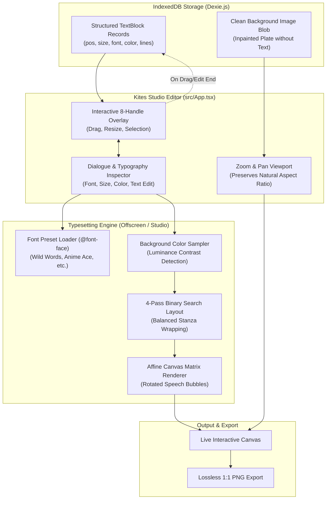
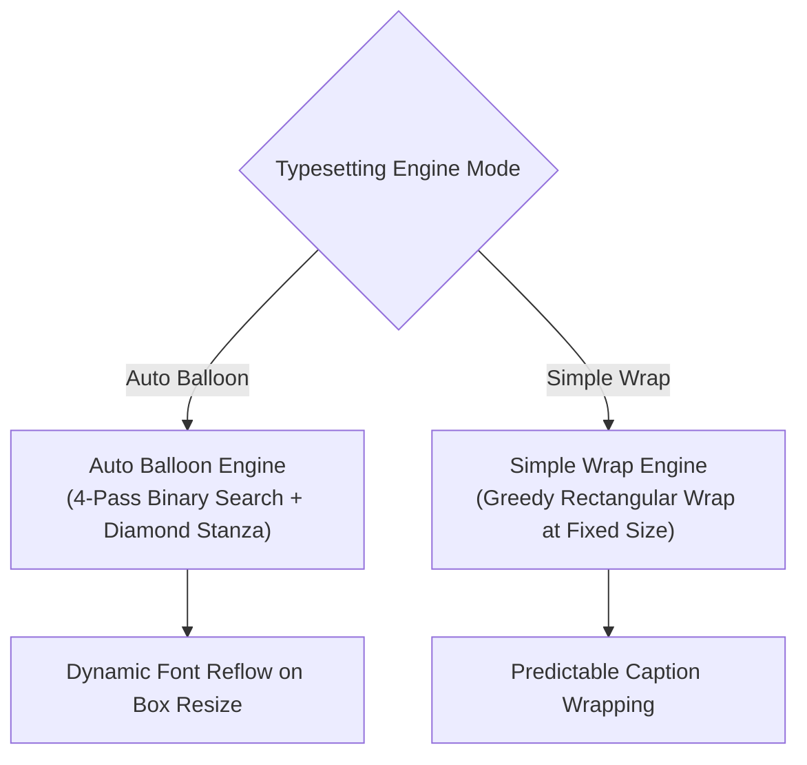

# Studio Editor & Typesetting Architecture 🎨

The **Kites Studio** (`src/App.tsx`) and **Typesetting Engine** (`src/offscreen/utils/canvasTypesetting.ts`, `typesetLayout.ts`, `cotransDefaultRenderer.ts`) provide an interactive desktop environment for reviewing comic translations, editing dialogue, adjusting typography, and exporting publication-ready comic pages.

---

## 🏗️ Architectural Topology



---

## 🧩 Clean Plate Storage & Non-Destructive Editing

Traditional translation tools destructively burn translated text into the image, making it impossible to fix typos or adjust layout after the pipeline completes.

Kites adopts a **Clean Plate Architecture**:
1. **Separation of Background and Text:**
   - The database persists `translatedImageBlob` as a **clean inpainted background plate** (character text erased, artwork reconstructed).
   - Dialogue data is persisted independently as an array of `TextBlock` records:
     ```ts
     export interface TextBlock {
       id?: number;
       imageId: number;
       originalText: string;
       translatedText: string;
       posX: number;
       posY: number;
       width: number;
       height: number;
       fontSize: number;
       fontFamily: string;
       color: string;
       strokeColor?: string;
       direction?: 'h' | 'v';
       lines?: string[];
     }
     ```
2. **Infinite Re-Typesetting:**
   Because text is rendered dynamically over the clean background, users can change fonts, resize speech bubbles, adjust colors, or retranslate text without degrading the underlying artwork.
3. **Zero-Migration `typesetBox` Studio Parity:**
   When speech bubble expansion is enabled, `posX, posY, width, height` in `db.textBlocks` are set directly to the validated expanded `typesetBox` coordinates rather than the narrow raw OCR bounding box. This guarantees 100% WYSIWYG parity between the baked in-page translation and the Studio desktop editor without requiring any Dexie schema migration.

---

## 📐 Interactive Bounding Box Manipulation & Gesture State Machine

In Kites Studio, each speech balloon is represented as an interactive bounding box overlay managed through a robust gesture state machine:

### 1. Pointer Gesture State Machine & Drag Deadzone
To eliminate conflicts between selection, double-click editing, and dragging:
1. **Screen-Pixel Deadzone (3px):** Mouse movements below 3px screen distance are treated as stationary clicks. Movement exceeding 3px transitions to active dragging and sets `hasMoved = true`.
2. **Double-Click Disambiguation:** Double-click detection for inline text editing occurs on `handlePointerUp` only when `hasMoved === false` and the time delta between clicks is $< 350\text{ ms}$ on the same target. This guarantees that dragging at any speed never freezes or accidentally triggers text editing.
3. **RAF-Throttled Layout Reflow:** Binary search font fitting (`recalculateBlockTypeset`) is throttled to `requestAnimationFrame` ticks during live move/resize gestures, preventing 60–240 Hz layout thrashing and UI stutter.
4. **Handle Hit Radius Clamping:** Resize handle hit radii in `CanvasFurniture.ts` are dynamically clamped:
   $$R_{\text{handle}} = \max\left(3, \min(W, H) \times 0.28\right)$$
   This ensures corner/edge handles never swallow the interior body of narrow vertical dialogue bubbles, keeping them easily draggable.
5. **Cancellation Rollback:** Handling `pointercancel` cleanly restores the box transform to the `initialTransform` snapshot without saving dirty undo transactions.

### 2. Viewport-to-Canvas Coordinate Normalization
User pointer interactions take place in viewport CSS pixels, which vary with zoom level and pan offsets. Kites normalizes pointer coordinates to the image's original native pixels:
$$X_{\text{natural}} = \frac{X_{\text{pointer}} - X_{\text{pan}}}{\text{Scale}}$$
$$Y_{\text{natural}} = \frac{Y_{\text{pointer}} - Y_{\text{pan}}}{\text{Scale}}$$

### 3. Rotated Transforms & Curved Handle Snapping
- **Angle Persistence:** Persists OCR detected orientation angles (`angle`) on text blocks.
- **Rotation Slider & Handle:** Features a rotation slider and curved rotation handle with angular snapping (snaps to multiples of $45^\circ$ within a $3^\circ$ threshold).
- **Affine Matrix Transformation:** Bounding box furniture, selection outlines, and text lines rotate synchronously around the box centroid using 2D canvas transforms.

---

## 🎛️ Dual Typesetting Engine Toggle (Auto Balloon vs Simple Wrap)

Studio V2 provides a dedicated **Typesetting Engine** switcher in `TypographySettings.tsx` (see ADR-008):



1. **`Auto Balloon` Mode (Default for Detected Dialogue):**
   - Implements 4-pass binary search fitting and balanced diamond line-envelope wrapping (`typesetLayout.ts`).
   - Automatically reflows line wraps and scales font size as the user drags resize handles.
   - Employs strict 7-letter hyphenation and Kinsoku Shori punctuation rules.
2. **`Simple Wrap` Mode (For Narration & Rectangular Boxes):**
   - Implements greedy rectangular word-wrapping at a fixed user-defined font size (`studioTypeset.ts`).
   - Preserves exact user font choices without automatic downscaling or diamond curvature.
3. **Dual Editing Scope Integration:**
   - When text boxes are selected, toggling updates the active boxes locally.
   - When no text boxes are selected, toggling updates the global studio default for newly created boxes.

---

## 🔤 Typography & Font Preset System (`renderFontPresets.ts`)

Kites includes an extensible font registry tailored for manga and comics lettering:

| Preset ID | Family Label | Typographic Role | Primary Font Stack |
| :--- | :--- | :--- | :--- |
| `standard` | Standard | Clean modern sans-serif | `sans-serif` |
| `comic` | Wild Words | Classic manga dialogue | `"Kites Comic", "Wild Words", cursive, sans-serif` |
| `anime-ace`| Anime Ace | Shonen action lettering | `"Anime Ace 2.0 BB", "Anime Ace", cursive` |
| `comic-hand`| Comic Hand | Informal handwriting / small caps | `"Patrick Hand SC", "Comic Sans MS", cursive` |
| `serif` | Serif | Literary prose & narration boxes | `Georgia, "Times New Roman", serif` |
| `monospace` | Monospace | Digital screens & system messages | `"Courier New", Courier, monospace` |

### Font Loading Invariant
Before executing text measurement on canvas, the engine awaits font readiness:
```ts
if (typeof document !== 'undefined' && document.fonts) {
  await document.fonts.ready;
}
```
This guarantees that `ctx.measureText` reflects real glyph metrics rather than system fallback widths.

---

## 🎨 Background Color Sampling & Contrast Preservation

Comic text appears on diverse backgrounds: bright white speech balloons, dark nighttime panels, or screaming black spiky balloons. Hardcoding black-on-white text destroys dark panels.

Kites ports XianScan's **color sampling algorithm** (`textColor.ts`):
1. **Sampling Ring:** Samples pixels in a narrow band outside the text polygon but inside the speech bubble perimeter.
2. **Perceived Luminance Formula:**
   $$Y = 0.299R + 0.587G + 0.114B$$
3. **Contrast Decision:**
   - **Light Background ($Y \ge 128$):** Primary text `#000000` (black) with `#FFFFFF` (white) outline stroke.
   - **Dark Background ($Y < 128$):** Primary text `#FFFFFF` (white) with `#000000` (black) outline stroke.
4. **Stroke Padding:** Text outlines are rendered with `lineWidth = \max(2, \text{fontSize} \times 0.15)$ using `lineJoin = 'round'` to prevent text collisions with screentones.

---

## 📐 4-Pass Binary Search Typesetting Layout

To fill irregularly shaped comic speech balloons without overflowing, Kites runs an iterative layout engine:

1. **Pass 1 (Binary Fit):** Binary searches font size between $6\text{ px}$ and the balloon height until all lines wrap within safety margins.
2. **Pass 2 (Tall-Box Aspect Cap):** When balloon aspect ratio $H / W \ge 2.0$, clamps font size to prevent narrow speech bubbles from blowing up font sizes unnaturally.
3. **Pass 3 (Hyphenation Scan):** Uses `hypher` with language hyphenation patterns to break words $\ge 7$ characters across lines in narrow balloons, preventing single-word line overflows.
4. **Pass 4 (Readability Floor):** Enforces a minimum $6\text{ px}$ floor to guarantee legible text.
5. **Balanced Stanza Wrapping:** Evaluates multiple wrapping options to balance line lengths into an inverted pyramid or centered diamond stanza.
6. **2D Affine Transformation:** For balloons tilted by $|\theta| \ge 3^\circ$, text is drawn through affine rotation matrices (`ctx.translate`, `ctx.rotate`).

---

## ✍️ Direct Inline Dialogue Editing & Live AI Inpaint Brush

Studio V2 provides direct on-canvas dialogue editing and interactive inpainting:

### 1. Direct In-Place Text Editing
- Double-clicking a text box or clicking the pen icon mounts an inline `<textarea>` placed at the exact bounding box location:
  $$X_{\text{box}} = \text{obj}.x \times \text{zoom}, \quad Y_{\text{box}} = \text{obj}.y \times \text{zoom}$$
- **Zero Ghosting:** While `editingTextId` is active, the overlay canvas explicitly skips rendering that text object, preventing double-rendered text shadows.
- **Subpixel Vertical Centering:** Dynamic vertical padding aligns the textarea text with the canvas font baseline:
  $$\text{Padding}_{\text{vert}} = \max\left(0, \left\lfloor \frac{\text{BoxHeight} - \text{ContentHeight}}{2} \right\rfloor \right)$$
- **CJK Vertical Mode:** When text contains CJK glyphs and `isVertical` is true, applies `writingMode: 'vertical-rl'`.

### 2. Localized AI Brush Inpainting & 3-Way View Mode
- **3-Way View Switcher:** Toggles canvas display between:
  - `Original`: Displays the untouched raw image for quick verification.
  - `Inpainted`: Displays the clean plate background with all dialogue layers hidden, enabling dedicated artwork inspection.
  - `Typeset`: Displays the full composite translated page.
- **Inpaint Source Selection:** Allows users to choose whether manual brush operations sample from the `Inpainted` background plate (default) or the `Original` raw image.
- **Universal Brush Gestures:** Supports continuous click-and-drag strokes for erase and paint brushes with live overlay previews.
- **Stroke Mask Extraction:**
  1. `BrushEngine` records the user's stroke raster into `dabCanvas`.
  2. `StudioCanvas` renders the exact stroke path into `maskCanvas` with relative crop offsets.
  3. Offscreen RPC decodes the mask patch and runs `extractMaskPolygons()` using connected-component analysis, extracting tight 4-point bounding polygons for each drawn stroke blob.
  4. The inpaint manager erases strictly within the stroke contours, preserving unstroked context across the rest of the patch.

### 3. Partial Word Styling & Inline Runs
- Allows users to highlight specific words or phrases inside a dialogue box and apply distinct typography (e.g. bold emphasis, alternate color, or custom font preset) without splitting the container.
- Prevents resize handle collisions and cursor thrashing on small highlighted words.

### 4. Reactive Store Invariants for Hotkeys & Context Menu
- Canvas hotkeys (`Delete`, `Backspace`, `Ctrl+D`, `Space` for pan) read live state from `studioStore.getState().textObjects` rather than stale component closures, preventing accidental reverts of intervening dialogue edits.
- Custom canvas context menu provides quick access to box duplication, z-index reordering (`Bring to Front`, `Send to Back`), deletion, and OCR re-scanning.

---

## 📤 High-Resolution Lossless Export & Canvas Untaint

Kites Studio renders directly onto a hidden full-resolution `OffscreenCanvas`:
1. **Canvas Untaint Guard:** Ensures all source images (clean plate blobs and background layers) are loaded as same-origin Blobs or authenticated Data URLs. Prevents browser security exceptions (`SecurityError: The operation is insecure`) when invoking `toDataURL()` or `toBlob()`.
2. **Lossless Vector Composition:**
   - Renders the clean inpainted background bitmap at 100% native resolution.
   - Renders each `TextBlock` using vector canvas primitives (`fillText`, `strokeText`, `setTransform`).
3. **Multi-Format Export:**
   - **PNG:** Lossless compression preserving all crisp text edges and transparency.
   - **JPEG:** High-quality lossy compression (quality 0.92) for smaller file sizes.
   - **Clipboard Copy:** Encodes the canvas directly as a binary `image/png` clipboard item via `navigator.clipboard.write([new ClipboardItem({ 'image/png': blob })])`.
4. **Metadata & Info Inspector:**
   - The Studio Inspector panel displays full translation metadata: source language, target language, OCR engine tier, inpaint model used, translation provider, bounding box count, and processing timestamps.
