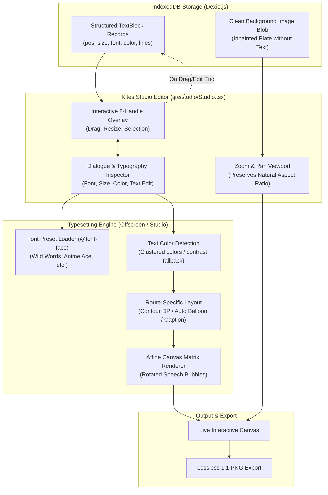
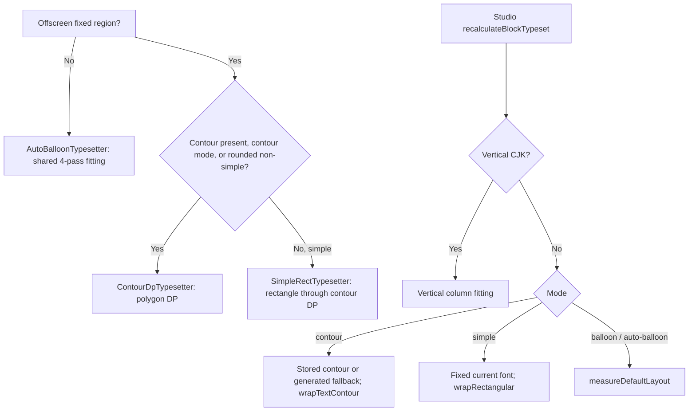
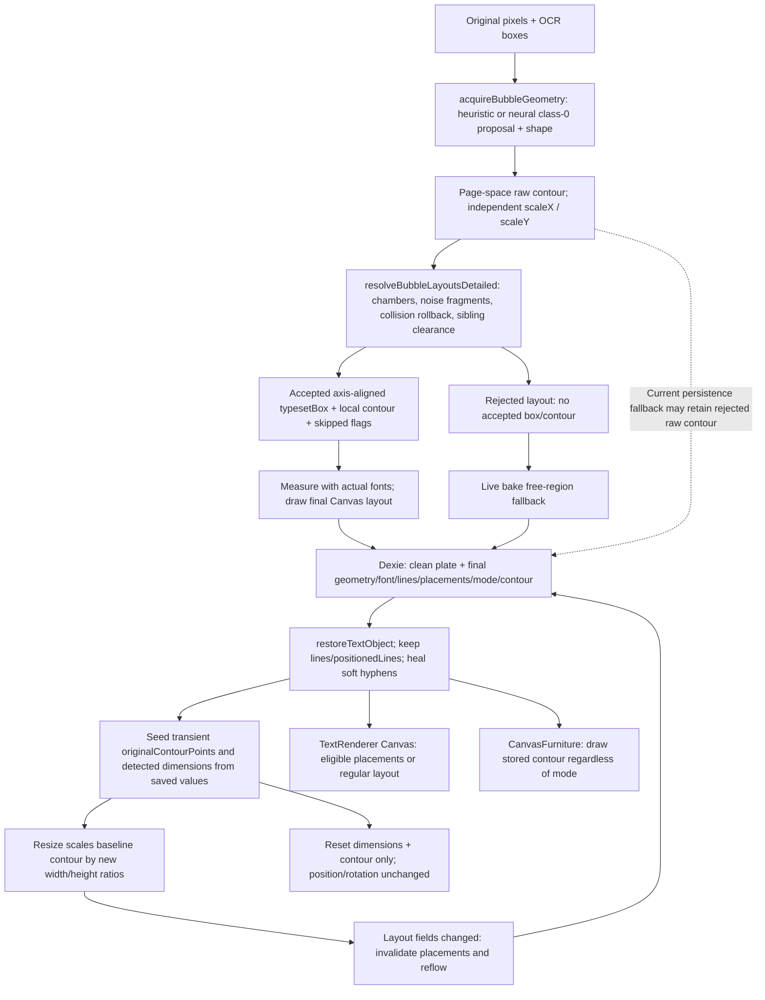

# Studio Editor & Typesetting Architecture 🎨

The **Kites Studio** (`src/studio/Studio.tsx`, hosted by `src/App.tsx`) and **Typesetting Engine** (`src/offscreen/utils/canvasTypesetting.ts`, `typesetLayout.ts`, `cotransDefaultRenderer.ts`) provide an interactive desktop environment for reviewing comic translations, editing dialogue, adjusting typography, and exporting publication-ready comic pages.

---

## Current implementation status (2026-10-28)

Audited cumulative `origin/main..main` through `656d720` against current code. The earlier dual-mode, font-ready-only, and universal four-pass descriptions are superseded by the route-specific notes below. Historical phase plans remain history, not proof of current behavior or end-to-end pixel parity.

- `src/studio/Studio.tsx` owns the editor; `src/App.tsx` hosts application/history navigation.
- `src/studio/canvas/TextRenderer.ts` paints **Canvas 2D**, not SVG. Furniture is also Canvas; the inline textarea is a DOM editing surface, not the final renderer.
- Backend strategy dispatch and Studio edit dispatch are related but not identical. Stored contour visibility is not evidence that the baked solver used that contour.

## 🏗️ Architectural Topology



---

## 🧩 Clean Plate Storage & Non-Destructive Editing

Traditional translation tools destructively burn translated text into the image, making it impossible to fix typos or adjust layout after the pipeline completes.

Kites adopts a **Clean Plate Architecture**:
1. **Separation of Background and Text:**
   - The database persists `translatedImageBlob` as a **clean inpainted background plate** (character text erased, artwork reconstructed).
   - Dialogue data is persisted independently as an array of `TextBlock` records:
     ```ts
     export interface TextBlock {
       id?: number;
       imageId: number;
       originalText: string;
       translatedText: string;
       posX: number;
       posY: number;
       width: number;
       height: number;
       fontSize: number;
       fontFamily: string;
       color: string;
       strokeColor?: string;
       direction?: 'h' | 'v';
       lines?: string[];
     }
     ```
2. **Infinite Re-Typesetting:**
   Because text is rendered dynamically over the clean background, users can change fonts, resize speech bubbles, adjust colors, or retranslate text without degrading the underlying artwork.
3. **Stored Current Layout (Not Complete Detection History):**
   `PipelineOrchestrator` prefers actual rendered destination geometry, then an accepted `typesetBox`, then the OCR box when saving `posX, posY, width, height`. Lines, font size and optional positioned placements are saved separately. This improves initial layout continuity but does not guarantee pixel parity or preserve complete original detection history; see the lifecycle limitations below.

---

## 📐 Interactive Bounding Box Manipulation & Gesture State Machine

In Kites Studio, each speech balloon is represented as an interactive bounding box overlay managed through a robust gesture state machine:

### 1. Pointer Gesture State Machine & Drag Deadzone
To eliminate conflicts between selection, double-click editing, and dragging:
1. **Screen-Pixel Deadzone (3px):** Mouse movements below 3px screen distance are treated as stationary clicks. Movement exceeding 3px transitions to active dragging and sets `hasMoved = true`.
2. **Double-Click Disambiguation:** Double-click detection for inline text editing occurs on `handlePointerUp` only when `hasMoved === false` and the time delta between clicks is $< 350\text{ ms}$ on the same target. This guarantees that dragging at any speed never freezes or accidentally triggers text editing.
3. **RAF-Throttled Layout Reflow:** Binary search font fitting (`recalculateBlockTypeset`) is throttled to `requestAnimationFrame` ticks during live move/resize gestures, preventing 60–240 Hz layout thrashing and UI stutter.
4. **Handle Hit Radius Clamping:** Resize handle hit radii in `CanvasFurniture.ts` are dynamically clamped:
   $$R_{\text{handle}} = \max\left(3, \min(W, H) \times 0.28\right)$$
   This ensures corner/edge handles never swallow the interior body of narrow vertical dialogue bubbles, keeping them easily draggable.
5. **Cancellation Rollback:** Handling `pointercancel` cleanly restores the box transform to the `initialTransform` snapshot without saving dirty undo transactions.

### 2. Viewport-to-Canvas Coordinate Normalization
User pointer interactions take place in viewport CSS pixels, which vary with zoom level and pan offsets. Kites normalizes pointer coordinates to the image's original native pixels:
$$X_{\text{natural}} = \frac{X_{\text{pointer}} - X_{\text{pan}}}{\text{Scale}}$$
$$Y_{\text{natural}} = \frac{Y_{\text{pointer}} - Y_{\text{pan}}}{\text{Scale}}$$

### 3. Rotated Transforms & Curved Handle Snapping
- **Angle Persistence:** Persists OCR detected orientation angles (`angle`) on text blocks. Studio re-OCR and full-page retranslate derive the centered, unrotated rectangle from the merged polygon and carry OcrManager's snapped block angle into the new object, so editing does not flatten tilted lettering.
- **Rotation Slider & Handle:** Features a rotation slider and curved rotation handle with angular snapping (snaps to multiples of $45^\circ$ within a $3^\circ$ threshold).
- **Affine Matrix Transformation:** Bounding box furniture, selection outlines, and text lines rotate synchronously around the box centroid using 2D canvas transforms.

---

## Typesetting Modes: Backend vs Studio Edits

The shared `TypesetMode` union is `contour | simple | auto-balloon | balloon`; `balloon` is the retained Auto Balloon alias. Legacy persisted `ellipse` restores as `contour`. Studio labels are **Contour**, **Auto Balloon**, and **Caption Box**. Selection changes affect selected objects; without selection, the setting is a default for future edits/objects, not an automatic rewrite of every existing layout.



A fixed contour takes priority in `TypesetStrategyFactory.resolve()`, even with a `simple` label. Studio simple edits instead use their explicit branch and fixed-font wrapping. Contour DP uses a 9px default floor and current custom 18/20/24px ceilings (dense dialogue / short dialogue / single uppercase scream); the shared free fitter can search down to 6px. **These caps are not Koharu parity:** donor bubble maximum is horizontal width or vertical height; 24 is only the donor nonbubble maximum.

---

## 🔤 Typography & Font Preset System (`renderFontPresets.ts`)

Kites includes an extensible font registry tailored for manga and comics lettering:

| Preset ID | Family Label | Typographic Role | Primary Font Stack |
| :--- | :--- | :--- | :--- |
| `standard` | Standard | Clean modern sans-serif | `sans-serif` |
| `comic` | Wild Words | Classic manga dialogue | `"CC Wild Words", "WildWords", "CCWildWords", "Kites Comic", sans-serif` |
| `anime-ace`| Anime Ace | Shonen action lettering | `"Anime Ace", "MTO Comic 2", cursive, sans-serif` |
| `comic-hand`| Comic Hand | Informal handwriting / small caps | `"Patrick Hand SC", "Comic Sans MS", cursive` |
| `serif` | Serif | Literary prose & narration boxes | `Georgia, "Times New Roman", serif` |
| `monospace` | Monospace | Digital screens & system messages | `"Courier New", Courier, monospace` |

### Font Registration, Measurement & Drawing

Preset families come from `src/shared/renderFontPresets.ts`; downloadable choices come from `src/shared/fontCatalog.ts`, not duplicated UI literals. Comic presets now lead with `"CC Wild Words"` and `"Anime Ace"`; bundled `@font-face` rules also include Patrick Hand SC. The on-demand library supports catalog downloads with pinned SHA-256 verification and user imports; Dexie schema v6 adds a `fonts` table containing raw bytes and family metadata.

`font:<family>` selections resolve to a sanitized library family. Each document must register persisted bytes through `ensureFontsRegistered()` / `FontFace.load()` / `document.fonts.add()`. The live bake explicitly loads named selected families before `document.fonts.ready`, because readiness alone does not request every declared face. Studio starts library registration asynchronously; failures can still use browser fallback. Its Canvas renderer is not a font-readiness or pixel-parity guarantee. See the detailed [font resolution/measurement/draw flow](../development/cotrans_renderer_spec.md#2-font-resolution-measurement--draw-lifecycle).

### Color & Outline Routes

The current pipeline supports per-block ink/background clustering (`textColor.ts`, `textColorDetection.ts`) with anti-alias fringe rejection and black/white snapping, plus fallback contrast sampling. The older single luminance-threshold description was incomplete. Final offscreen outlines use `2 * max(trunc(fontSize * 0.07), 1)` when enabled, then a separate fill pass. Studio `TextRenderer` uses object `strokeWidth * 2` and supports styled runs/gradients; restored objects currently default to stroke width 2. These separate paint policies can differ visually.

### Bubble Geometry, Database & Studio Lifecycle



**Persisted layout is not the full detection history.** `TextBlock` stores `contourPoints`, `positionedLines`, current geometry, lines, font, mode, curvature and skipped status. `originalContourPoints`, `detectedWidth` and `detectedHeight` are transient Studio fields, not persisted columns/payload fields. On reload they are reseeded from the current saved contour and dimensions, so reset is relative to that restored frame, not necessarily the original detector frame. `Reset to Bubble Frame` does not restore position or rotation.

**Known integration limitation:** `PipelineOrchestrator` prefers detailed accepted contours but falls back to raw acquisition contours while saving. It can also classify the saved mode from proposal/carrier evidence after the live layout was rejected. A later Studio contour reflow can therefore differ from the free-region bake. `CanvasFurniture` draws any stored non-skipped contour with at least three points regardless of `typesetMode`; its dashed white halo/accent outline proves storage only, not acceptance or solver use.

`TextRenderer` uses stored positioned lines when their count matches, coordinates are finite, and per-character styling does not require regular rendering. Edits invalidate/recompute placements. Backend and Studio share useful data, but there is no verified end-to-end pixel parity claim.

`runStudioOcr()` shares acquisition/resolution helpers but currently uses an unconditional geometry acceptance callback and precomputes horizontal layout through `wrapTextContour()` with a hardcoded comic font, including rectangle fallbacks. It is not the live bake's selected-font acceptance path. The offscreen response adds patch offsets; the bridge seeds initial contour/dimension baselines for resizing. Studio guards long-running retranslation/colorization results against page switches and clears undo history on page identity changes; this does not imply every asynchronous UI read is guarded.

---

## ✍️ Direct Inline Dialogue Editing & Live AI Inpaint Brush

Studio V2 provides direct on-canvas dialogue editing and interactive inpainting:

### 1. Direct In-Place Text Editing
- Double-clicking a text box or clicking the pen icon mounts an inline `<textarea>` placed at the exact bounding box location:
  $$X_{\text{box}} = \text{obj}.x \times \text{zoom}, \quad Y_{\text{box}} = \text{obj}.y \times \text{zoom}$$
- **Zero Ghosting:** While `editingTextId` is active, the overlay canvas explicitly skips rendering that text object, preventing double-rendered text shadows.
- **Subpixel Vertical Centering:** Dynamic vertical padding aligns the textarea text with the canvas font baseline:
  $$\text{Padding}_{\text{vert}} = \max\left(0, \left\lfloor \frac{\text{BoxHeight} - \text{ContentHeight}}{2} \right\rfloor \right)$$
- **CJK Vertical Mode:** When text contains CJK glyphs and `isVertical` is true, applies `writingMode: 'vertical-rl'`.

### 2. Localized AI Brush Inpainting & 3-Way View Mode
- **3-Way View Switcher:** Toggles canvas display between:
  - `Original`: Displays the untouched raw image for quick verification.
  - `Inpainted`: Displays the clean plate background with all dialogue layers hidden, enabling dedicated artwork inspection.
  - `Typeset`: Displays the full composite translated page.
- **Inpaint Source Selection:** Allows users to choose whether manual brush operations sample from the `Inpainted` background plate (default) or the `Original` raw image.
- **Universal Brush Gestures:** Supports continuous click-and-drag strokes for erase and paint brushes with live overlay previews.
- **Stroke Mask Extraction:**
  1. `BrushEngine` records the user's stroke raster into `dabCanvas`.
  2. `StudioCanvas` renders the exact stroke path into `maskCanvas` with relative crop offsets.
  3. Offscreen RPC decodes the mask patch and runs `extractMaskPolygons()` using connected-component analysis, extracting tight 4-point bounding polygons for each drawn stroke blob.
  4. The inpaint manager erases strictly within the stroke contours, preserving unstroked context across the rest of the patch.

### 3. Partial Word Styling & Inline Runs
- Allows users to highlight specific words or phrases inside a dialogue box and apply distinct typography (e.g. bold emphasis, alternate color, or custom font preset) without splitting the container.
- Prevents resize handle collisions and cursor thrashing on small highlighted words.

### 4. Reactive Store Invariants for Hotkeys & Context Menu
- Canvas hotkeys (`Delete`, `Backspace`, `Ctrl+D`, `Space` for pan) read live state from `studioStore.getState().textObjects` rather than stale component closures, preventing accidental reverts of intervening dialogue edits.
- Custom canvas context menu provides quick access to box duplication, z-index reordering (`Bring to Front`, `Send to Back`), deletion, and OCR re-scanning.

---

## 📤 High-Resolution Lossless Export & Canvas Untaint

Kites Studio renders directly onto a hidden full-resolution `OffscreenCanvas`:
1. **Canvas Untaint Guard:** Ensures all source images (clean plate blobs and background layers) are loaded as same-origin Blobs or authenticated Data URLs. Prevents browser security exceptions (`SecurityError: The operation is insecure`) when invoking `toDataURL()` or `toBlob()`.
2. **Native-Resolution Canvas Composition:**
   - Renders the clean inpainted background bitmap at 100% native resolution.
   - Rasterizes each text object using Canvas text primitives (`fillText`, `strokeText`, transforms). PNG losslessness does not mean vector output or donor pixel parity.
3. **Multi-Format Export:**
   - **PNG:** Lossless compression preserving all crisp text edges and transparency.
   - **JPEG:** High-quality lossy compression (quality 0.92) for smaller file sizes.
   - **Clipboard Copy:** Encodes the canvas directly as a binary `image/png` clipboard item via `navigator.clipboard.write([new ClipboardItem({ 'image/png': blob })])`.
4. **Metadata & Info Inspector:**
   - The Studio Inspector panel displays full translation metadata: source language, target language, OCR engine tier, inpaint model used, translation provider, bounding box count, and processing timestamps.
