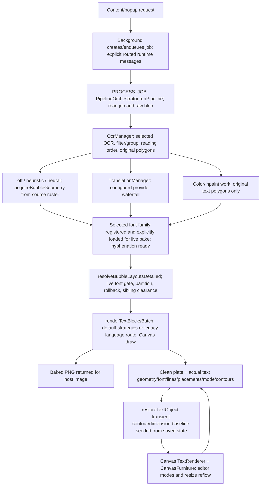

# Kites Architecture & Execution Flow Map

**Pipeline Orchestrator**: `src/offscreen/services/PipelineOrchestrator.ts` -> `PipelineOrchestrator.runPipeline(jobId)`

## Current execution map — 2026-10-28

The original ASCII diagram and function index below are retained as **historical snapshots**, not a current API inventory. In particular, their `action` messaging examples, old OCR labels, `ballonExtractor`, raw-mask forwarding, `layoutLines`, old hyphenation path and intermediate renderer assumptions must not be used as implementation instructions. Current cumulative `origin/main..main` through `656d720` follows this map.



### Verified current source map

- **Job and media persistence:** `src/offscreen/services/PipelineOrchestrator.ts`, `src/db.ts`. Project-owned jobs are exempt from retention cleanup. Webpage receives baked PNG; DB receives clean plate plus text blocks, not that baked bitmap as its background.
- **Bubble geometry:** `src/offscreen/services/BubbleLayoutService.ts`, `src/offscreen/utils/maskContourExtractor.ts`, `src/offscreen/utils/geometry/`. Runtime modes are `off`, `heuristic`, `neural`; separate `neural-mask` is retired. Mask projection uses independent X/Y scales. Curved shared balloons use flow-cell partitioning, not only axis-aligned chain splits; tiny absorbed fragments persist as skipped.
- **Inpaint boundary:** `src/offscreen/services/InpaintManager.ts` receives original text polygons. `maskRawCanvas` is diagnostic; expanded boxes/contours are not eraser masks. Historical Stage 3's mask-forwarding wording is superseded.
- **Strategy resolution:** `src/offscreen/engines/typeset/TypesetStrategyFactory.ts`; fixed contour evidence wins before simple, otherwise Auto Balloon. Backend `SimpleRectTypesetter` calls Contour DP with a rectangle. `balloon` and `auto-balloon` both mean Auto Balloon; legacy `ellipse` restores as contour.
- **Font and draw:** `src/shared/renderFontPresets.ts`, `src/shared/fontCatalog.ts`, `src/shared/fontLibrary.ts`, `src/offscreen/utils/canvasTypesetting.ts`, `src/offscreen/utils/cotransDefaultRenderer.ts`. Library bytes live in Dexie v6 `fonts`; faces register per document. Live bake preloads named selected families before measurement. Final renderer uses affine Canvas stroke/fill, not SVG or a required rasterize-then-warp stage. Full [font flow](../development/cotrans_renderer_spec.md#2-font-resolution-measurement--draw-lifecycle).
- **Current custom font ceiling:** shared Contour DP's 18/20/24 dialogue caps are not donor parity. Koharu bubble automatic maximum is width horizontally or height vertically; 24 is only nonbubble. Nonempty/overflow fallback output does not prove containment.
- **Studio lifecycle:** `src/studio/state/persistedTextObjects.ts`, `src/studio/canvas/studioTypeset.ts`, `src/studio/canvas/TextRenderer.ts`, `src/studio/canvas/CanvasFurniture.ts`. Retain eligible positioned lines initially; edits invalidate/reflow. Studio simple edits are fixed-font rectangular wrapping, unlike backend fitting. Stored contours draw regardless of mode and do not prove solver use.
- **Known persistence/reset gaps:** pipeline save can reuse a rejected raw acquisition contour and classify mode using carrier/proposal evidence. `originalContourPoints` / `detectedWidth` / `detectedHeight` are not persisted, only reseeded from saved values. Reset restores dimensions/contour, not position/rotation. [Lifecycle flow and details](../architecture/studio-and-typesetting.md#bubble-geometry-database--studio-lifecycle).
- **Studio OCR is a separate seam:** `src/offscreen/services/StudioOcr.ts` shares geometry but uses unconditional acceptance and hardcoded comic-family horizontal contour precomputation; the offscreen response adds patch offsets and the bridge prepares transient baselines. This differs from live selected-font bake. Long-running Studio retranslation/colorization rejects stale page results; undo history clears on page switches.

Visual tests, fixtures and Chrome probe scripts cover selected behavior; no end-to-end donor pixel-parity claim follows from their names or presence.

---

### Historical technical flow diagram (superseded where noted above)


```
[ Extension / Content Script Request ] (`chrome.runtime.sendMessage({ action: 'TRANSLATE_IMAGE' })`)
       │
       │  Stage 1: Background & Offscreen Message Dispatch
       │  File: src/background/index.ts -> chrome.runtime.onMessage.addListener()
       │  File: src/offscreen/index.ts -> chrome.runtime.onMessage.addListener()
       │  File: src/db.ts -> db.translationJobs & db.images
       ▼
┌─────────────────────────────────────────────────────────────────────────────────────────────┐
│ 1. Offscreen handler calls `PipelineOrchestrator.runPipeline(jobId)`                         │
│ 2. `db.translationJobs.update(jobId, { status: 'processing' })`                              │
│ 3. Fetches `rawImageBlob` from IndexedDB and converts to ArrayBuffer                         │
└──────────────────────────────────────────────┬──────────────────────────────────────────────┘
                                               │ `imageBuffer` (ArrayBuffer)
                                               ▼
       │  Stage 2: OCR & Text Detection (`OcrManager`)
       │  File: src/offscreen/services/OcrManager.ts -> OcrManager.processImage()
       │  File: src/offscreen/services/OcrManager.ts -> OcrManager.getOrLoadEngine(tier)
       │  File: src/offscreen/engines/ocr/PaddleOcrEngine.ts -> PaddleOcrEngine.detect() & recognizeCrops()
       │  File: src/shared/utils/geometry.ts -> assignTextDirections() & splitTextRegion()
┌──────┴──────────────────────────────────────────────────────────────────────────────────────┐
│ 1. Receives the selected engine tier (`'comic-text-detector'` or `'paddle-dbnet'`)             │
│ 2. CTD Engine (`CtdOcrEngine.ts`):                                                          │
│    - Detection: Forward pass through `comictextdetector.onnx` via ONNX Runtime Web         │
│    - Recognition: Delegates crop character reading to `PaddleOcrEngine.recognizeCrops()`   │
│ 3. Paddle Engine (`PaddleOcrEngine.ts`):                                                    │
│    - Detection: DBNet text detector                                                         │
│    - Recognition: PP-OCRv4 text recognizer                                                  │
│ 4. Direction & Merge Math (`geometry.ts`): `assignTextDirections()` majority vote &         │
│    `splitTextRegion()` Kruskal MST line merging into `TextBlock` objects                    │
│ 5. Output: `OcrResult` (`texts`, `boxes`, `polygons`, `directions`, `angles`, `lineCounts`)  │
└──────────────────────────────────────────────┬──────────────────────────────────────────────┘
                                               │ `ocrResult` ({ texts, polygons, lineCounts... })
                                               ▼
       │  Stage 3: OCR Mask Output (used by inpainting and optional bubble-fit rendering)
       │  File: src/offscreen/engines/ocr/extractPolygons.ts -> extractRawMaskCanvas()
       │  File: src/offscreen/engines/bubble/HeuristicBubbleExtractor.ts -> extractCarrierBox() [optional]
┌──────┴──────────────────────────────────────────────────────────────────────────────────────┐
│ 1. `extractRawMaskCanvas()` emits the detector's raw probability mask canvas                 │
│ 2. The default renderer does not use bubble extraction; `manga2eng` may use it separately    │
│ 3. Output: `maskRawCanvas` plus merged text-region polygons                                  │
└──────────────────────────────────────────────┬──────────────────────────────────────────────┘
                                               │ Mask Canvas & Polygons
                                               ▼
       │  Stage 4 & 5 (Parallel): Translation & Inpainting
       │  File: src/offscreen/services/PipelineOrchestrator.ts -> Promise.all([translation, inpaint])
       │  
       │  -- Branch A: Translation Waterfall (`TranslationManager`)
       │  File: src/offscreen/services/TranslationManager.ts -> TranslationManager.processTranslation()
       │  File: src/offscreen/engines/translation/WebLLMEngine.ts -> translate()
       │  File: src/offscreen/engines/translation/GoogleTranslateEngine.ts -> translate()
       │  
       │  -- Branch B: Inpainting & Background Erasure (`InpaintManager`)
       │  File: src/offscreen/services/InpaintManager.ts -> InpaintManager.eraseText()
       │  File: src/offscreen/services/InpaintCacheManager.ts -> getCachedOrInpaint()
       │  File: src/offscreen/engines/inpaint/LamaBaseInpaintEngine.ts -> eraseText()
       │  File: src/offscreen/engines/inpaint/TeleaInpaintEngine.ts -> eraseText()
┌──────┴──────────────────────────────────────────────────────────────────────────────────────┐
│ 1. Translation Waterfall: Sequentially executes Primary Engine -> Fallback Chain on error   │
│ 2. Inpainting: `LamaBaseInpaintEngine` runs `lama_fp16.onnx` via WebGPU/WASM to clean image │
│ 3. Output: `translatedTexts` (Array<string>) & `cleanedImageBuffer` (ArrayBuffer)           │
└──────────────────────────────────────────────┬──────────────────────────────────────────────┘
                                               │ `translatedTexts` & `cleanedImageBuffer`
                                               ▼
       │  Stage 6: Typesetting & Canvas Text Rendering
       │  File: src/offscreen/services/PipelineOrchestrator.ts -> renderTextBlocksBatch()
       │  File: src/offscreen/utils/cotransDefaultRenderer.ts -> resizeRegionToFontSize() & renderRegionDefault()
       │  File: src/offscreen/utils/canvasTypesetting.ts -> renderTextBlocksBatch() & layoutLines()
       │  File: src/offscreen/utils/hyphenation.ts -> syllables()
┌──────┴──────────────────────────────────────────────────────────────────────────────────────┐
│ 1. `renderTextBlocksBatch()` → `renderTextBlocksDefault()` builds region-based layout        │
│ 2. Font Sizing: Uses merged OCR-region geometry and source line count                        │
│ 3. Hyphenation & Line Wrapping: Fits English text into the rotated OCR region                │
│ 4. OffscreenCanvas Drawing: Renders text with outline stroke onto `cleanedImageBuffer`      │
│ 5. Output: `bakedBlob` (PNG Blob with rendered text burned in)                              │
└──────────────────────────────────────────────┬──────────────────────────────────────────────┘
                                               │ `bakedBlob` (Base64 DataURL)
                                               ▼
       │  Stage 7: Database Storage & Return Result
       │  File: src/offscreen/services/PipelineOrchestrator.ts -> db.images.update() & db.textBlocks.bulkAdd()
       │  File: src/db.ts -> IndexedDB persistence
┌──────┴──────────────────────────────────────────────────────────────────────────────────────┐
│ 1. Saves raw clean inpainted image (`cleanedBlob`) to `db.images`                           │
│ 2. Saves translated text blocks + final drawn font sizes to `db.textBlocks`                  │
│ 3. Updates job status: `db.translationJobs.update(jobId, { status: 'completed' })`           │
│ 4. Returns Base64 DataURL string (`bakedBase64`) to Content Script for instant display       │
└─────────────────────────────────────────────────────────────────────────────────────────────┘
```

---

### Historical code reference & function index (not current API inventory)

#### Stage 1: Pipeline Message Entry & DB Fetch
* **Message Listener**: `src/offscreen/index.ts` -> `chrome.runtime.onMessage.addListener()`
* **Main Orchestrator Entry**: `src/offscreen/services/PipelineOrchestrator.ts` -> `PipelineOrchestrator.runPipeline(jobId)`
* **Database Models**: `src/db.ts` -> `KitesDatabase` (`translationJobs`, `images`, `textBlocks`)

#### Stage 2: OCR & Text Detection
* **OCR Manager**: `src/offscreen/services/OcrManager.ts` -> `OcrManager.processImage()`
* **Engine Singleton Resolver**: `src/offscreen/services/OcrManager.ts` -> `OcrManager.getOrLoadEngine()`
* **CTD Engine (Comic Text Detector)**: `src/offscreen/engines/ocr/CtdOcrEngine.ts` -> `CtdOcrEngine.recognize()`
  * *Detection*: Forward pass through `comictextdetector.onnx` via ONNX Runtime Web.
  * *Recognition*: Calls `PaddleOcrEngine.recognizeCrops(imageBuffer, rawPolygons)` (Line 200).
* **Paddle Engine (PaddleOCR DBNet)**: `src/offscreen/engines/ocr/PaddleOcrEngine.ts` -> `PaddleOcrEngine.recognize()` & `recognizeCrops()`
  * *Detection*: DBNet text detector.
  * *Recognition*: PP-OCRv4 text recognizer.
* **Polygon Extractor**: `src/offscreen/engines/ocr/extractPolygons.ts` -> `extractPolygons()`
* **Reading Direction Voting**: `src/offscreen/services/OcrManager.ts` -> `assignTextDirections()`
* **Kruskal MST Region Merging**: `src/shared/utils/geometry.ts` -> `splitTextRegion()` & `quadrilateralCanMergeRegion()`

#### Stage 3: Mask Generation & Speech Bubble Extraction
* **Raw Mask Generator**: `src/offscreen/engines/ocr/extractPolygons.ts` -> `extractRawMaskCanvas()`
* **Optional Speech Bubble Boundary Extractor**: `src/offscreen/utils/ballonExtractor.ts` -> `extractBallonRegion()`

#### Stage 4: Translation Waterfall
* **Translation Manager**: `src/offscreen/services/TranslationManager.ts` -> `TranslationManager.processTranslation()`
* **Engine Waterfall Chain**: `src/offscreen/services/TranslationManager.ts` -> `processTranslation()` (iterates over `engineSequence`)
* **WebLLM Local LLM Engine**: `src/offscreen/engines/translation/WebLLMEngine.ts` -> `translate()`
* **Google Translate Engine**: `src/offscreen/engines/translation/GoogleTranslateEngine.ts` -> `translate()`

#### Stage 5: Inpainting & Erasure
* **Inpaint Manager**: `src/offscreen/services/InpaintManager.ts` -> `InpaintManager.eraseText()`
* **Cache Manager**: `src/offscreen/services/InpaintCacheManager.ts` -> `getCachedOrInpaint()`
* **LaMa WebGPU Engine**: `src/offscreen/engines/inpaint/LamaBaseInpaintEngine.ts` -> `LamaBaseInpaintEngine.eraseText()`
* **Telea OpenCV Engine**: `src/offscreen/engines/inpaint/TeleaInpaintEngine.ts` -> `TeleaInpaintEngine.eraseText()`

#### Stage 6: Typesetting & Canvas Rendering
* **Batch Render Entry**: `src/offscreen/services/PipelineOrchestrator.ts` -> calls `renderTextBlocksBatch()`
* **Cotrans Default Renderer**: `src/offscreen/utils/cotransDefaultRenderer.ts` -> `resizeRegionToFontSize()` & `renderRegionDefault()`
* **Canvas Renderer**: `src/offscreen/utils/canvasTypesetting.ts` -> `renderTextBlocksBatch()`, `layoutLines()`, `renderTextBlock()`
* **Hyphenation Helper**: `src/offscreen/utils/hyphenation/HyphenationService.ts` (current replacement for the historical single-file module) -> `syllables()`

#### Stage 7: Persistence & Return
* **Image Update**: `src/offscreen/services/PipelineOrchestrator.ts` -> `db.images.update()`
* **TextBlocks Saving**: `src/offscreen/services/PipelineOrchestrator.ts` -> `db.textBlocks.bulkAdd()`
* **Job Completion**: `src/offscreen/services/PipelineOrchestrator.ts` -> `db.translationJobs.update()`
