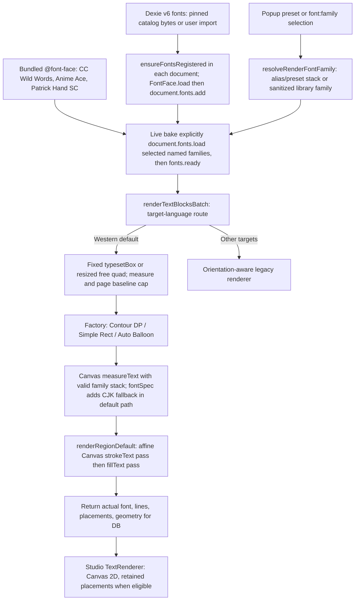

# Cotrans Default Region Renderer Specification

## 1. Overview & Purpose

The **Cotrans Default Region Renderer** is the final visual composition stage of the translation pipeline. It takes translated lines produced by one of the three typesetting strategies (Route 1, Route 2, or Route 3) and draws them directly onto the image canvas.

It uses Cotrans 2023 region geometry and browser-native Canvas 2D drawing, combined with Kites strategy routing and contour placements. This is not an end-to-end pixel-identical port: font metrics, rasterization, affine drawing and current font caps differ from donor renderers.

**Current-code audit: 2026-10-28, cumulative `origin/main..main` through `656d720`.** The active path draws glyphs directly to Canvas; intermediate text-rasterization helpers are not the active `renderRegionDefault()` composition path.

* **Batch Coordinator**: `src/offscreen/utils/canvasTypesetting.ts`.
* **Final Draw Coordinator**: `src/offscreen/utils/cotransDefaultRenderer.ts`.
* **Strategy Dispatch**: `src/offscreen/engines/typeset/TypesetStrategyFactory.ts`.
* **Shared Free-Region Fitter**: `src/offscreen/engines/typeset/AutoBalloonTypesetter.ts` and `src/offscreen/utils/typesetLayout.ts`.
* **Contour/Rectangle DP**: `src/offscreen/utils/contourTypeset.ts`.
* **Quad Geometry & Fit Predicate**: `src/offscreen/utils/renderer/regionGeometry.ts`.
* **Retained Helper**: `renderer/cotransLineBreaker.ts` supplies line-break utilities. `renderer/cotransTextRasterizer.ts` was deleted during the port cleanup; it is not an active rasterize-then-warp stage.

---

## 2. Font Resolution, Measurement & Draw Lifecycle

Font registration is document-local. Catalog downloads verify pinned SHA-256 before storing bytes; user imports do not have catalog hash verification. `ensureFontsRegistered()` caches its registration promise, so the diagram is a startup lifecycle, not a guaranteed cross-document live-update mechanism. Studio triggers registration asynchronously. Registration failures and the bake's explicit family-load failures can fall back to browser fonts; `fonts.ready` alone does not guarantee a requested face exists or that every route awaited it.

`fontSpec()` keeps comma-separated CSS stacks unquoted as a whole and orders CJK fallbacks according to sample text. Contour and Studio simple probes construct their own valid shorthand from the supplied family. Font availability and script fallback can therefore still differ between routes. `runStudioOcr()` currently precomputes horizontal contour layout with a hardcoded comic family; it does not perform the live bake's selected-preset preload/measurement sequence. Do not infer font or pixel parity from shared geometry alone.

Current Contour DP's 18/20/24px dialogue caps are custom policy. Upstream Koharu bubble automatic maximum is width (height for vertical writing); 24 applies only to nonbubble text.

## 3. Rigid 2D Affine Transformation Matrix

### 3.1 Why Direct Canvas Affine Transform Instead of OpenCV Homography?
Upstream Cotrans (Python) renders text onto a flat raster image and calls `cv2.findHomography` followed by `cv2.warpPerspective` to warp the bitmap onto the page.
In a browser extension, bitmap resampling causes severe bilinear blur and fuzzy text edges.

Because manga speech bubbles undergo **rigid Euclidean rotation and scaling** without perspective shear ($z$-axis tilt), Kites maps the destination quad using a native **2D Affine Transformation Matrix** directly on vector glyphs (`ctx.setTransform(a, b, c, d, e, f)`). This preserves native sub-pixel vector font anti-aliasing.

### 3.2 Mathematical Matrix Derivation
Given the 4 destination quad corners in order:
* Top-Left: $\mathbf{tl} = (x_{tl}, y_{tl})$
* Top-Right: $\mathbf{tr} = (x_{tr}, y_{tr})$
* Bottom-Right: $\mathbf{br} = (x_{br}, y_{br})$
* Bottom-Left: $\mathbf{bl} = (x_{bl}, y_{bl})$

The normalized edge lengths are computed across opposite edge midpoints:

$$\text{normH} = \left\| \frac{\mathbf{tl} + \mathbf{bl}}{2} - \frac{\mathbf{tr} + \mathbf{br}}{2} \right\|$$

$$\text{normV} = \left\| \frac{\mathbf{tl} + \mathbf{tr}}{2} - \frac{\mathbf{bl} + \mathbf{br}}{2} \right\|$$

The unit basis vectors along the horizontal top edge and vertical left edge form the transform matrix $\mathbf{M}$:

$$a = \frac{x_{tr} - x_{tl}}{\text{normH}}, \quad b = \frac{y_{tr} - y_{tl}}{\text{normH}}$$

$$c = \frac{x_{bl} - x_{tl}}{\text{normV}}, \quad d = \frac{y_{bl} - y_{tl}}{\text{normV}}$$

$$\mathbf{M} = \begin{bmatrix} a & c & x_{tl} \\ b & d & y_{tl} \\ 0 & 0 & 1 \end{bmatrix}$$

Calling `ctx.setTransform(a, b, c, d, x_{tl}, y_{tl})` aligns the coordinate system so local coordinates $(0, 0) \rightarrow (\text{normH}, \text{normV})$ map 1:1 onto the quad on the page.

---

## 4. Positioned Line Scanlines vs. Bounding Box Centering

### 4.1 The Waist-Pulling Problem in Multi-Lobe Balloons
In standard Cotrans 2023, the text block was vertically centered inside the container's outer bounding box:

$$y_{\text{start}} = \frac{\text{normV} - \text{totalBlockHeight}}{2}$$

In a figure-8 or hourglass bubble, this midpoint falls directly in the narrow constriction neck (20px width), pulling text 40–60px upward away from the bulb.

### 4.2 Positioned Line Scanlines
When the typesetter provides `PositionedLine[]` matching the drawable line count, each line uses its computed box-local top offset (`ctx.textBaseline = 'top'`), not an alphabetic baseline:

$$y_i = \begin{cases} \text{positionedLine}[i].y & \text{if positionedLines present} \\ y_{\text{start}} + i \cdot \text{lineStep} & \text{otherwise} \end{cases}$$

$$x_i = \begin{cases} \text{positionedLine}[i].x + \frac{\text{positionedLine}[i].\text{width} - W_i}{2} & \text{if positionedLines present} \\ \frac{\text{normH} - W_{\text{max}}}{2} + \frac{W_{\text{max}} - W_i}{2} & \text{center alignment otherwise} \end{cases}$$

Without positioned lines, left alignment uses the centered block's left edge and right alignment adds `maxLineWidth - lineWidth`; positioned spans override this per-line alignment.

This ensures dialogue text sits comfortably in the wide belly of the bubble lobe.

---

## 5. Stroke Outline & Background Adaptivity

### 5.1 Stroke Geometry & Line Spacing
* **Stroke Outline Width**:
  $$\text{bgSize}=\max(\operatorname{trunc}(\text{fontSize}\times0.07),1),\qquad \text{strokeWidth}=2\times\text{bgSize}$$
  Applied only when a nontransparent background/stroke color exists. At small sizes this means a 2px outline, not the previous formula's 1px.
* **Inter-line Spacing**:
  $$\text{spacingY} = \lfloor \text{fontSize} \times 0.01 \rfloor$$
* **Drawing Order**: `ctx.strokeText()` is drawn first with `lineJoin = 'round'` and `miterLimit = 2`, followed by `ctx.fillText()`. This guarantees the outline never eats into the interior of thin letter glyphs.

### 5.2 Left-Edge Bleed Shield
To prevent text strokes from clipping off the left edge of the page canvas on dialogue hugging the margin:

$$\text{if } (x_{tl} + x_i < 4) \implies x_i = 4 - x_{tl}$$

---

## 6. Screen-Space Coordinate Point Rotation

When unrotating regions to measure bounding dimensions and rotating back:

$$\begin{bmatrix} x' \\ y' \end{bmatrix} = \begin{bmatrix} x_c \\ y_c \end{bmatrix} + \begin{bmatrix} \cos\theta & \sin\theta \\ -\sin\theta & \cos\theta \end{bmatrix} \begin{bmatrix} x - x_c \\ y - y_c \end{bmatrix}$$
