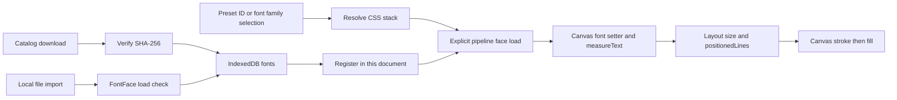

# Font Selection, Library Storage, and Canvas Readiness

Reviewed 2026-10-28 through `656d720`. See [ADR-009](../decisions/ADR-009-on-demand-font-catalog-and-koharu-2d-contour-invariants.md) for rationale and [Devlog 079](../dev-history/devlog/079_phase79_on_demand_font_catalog_and_picker.md) for implementation history.

## 1. Sources and identifiers

`src/shared/renderFontPresets.ts` owns the preset registry and identifiers. Presets include Standard, Wild Words, Anime Ace, Comic Hand, Serif, and Monospace. The default remains `standard`. `resolveRenderFontFamily()` converts preset identifiers into CSS family stacks. Library selections use `font:<family>`; those names are sanitized before interpolation. Identifier types are currently extensible strings, not an exhaustive compile-time list of catalog fonts.

`src/shared/fontCatalog.ts` owns 12 downloadable Latin-subset OFL entries: Comic Neue, Bangers, Luckiest Guy, Shantell Sans, Gochi Hand, Schoolbell, Indie Flower, Architects Daughter, Kalam, Permanent Marker, Coming Soon, and Caveat. Each entry records family, label, category, versioned gstatic URL, byte count, and pinned SHA-256.

This is a curated Kites catalog, not a mirror of Koharu's font collection. Koharu's inspected `fonts.rs` resolves a pinned `mayocream/fonts` dataset index and also supports system/fallback discovery. Matching its download architecture does not mean matching every font file, license, shaping result, or layout.

## 2. Bundled presets

`src/index.css` declares local assets for CC Wild Words aliases (`CC Wild Words`, `CCWildWords`, `WildWords`, `Kites Comic`), Anime Ace, the legacy MTO families, and Patrick Hand SC. Reference CC Wild Words and Anime Ace binaries were copied into `public/fonts/` in `cf6dadf`; Patrick Hand SC was bundled in `a5e7f9b`.

The Wild Words preset now prioritizes bundled aliases rather than depending on an installed local face or an MTO substitution. This makes the intended resource available, but syntax and load readiness still matter. `font-display: block` is not an awaited canvas-readiness API.

**Distribution boundary:** asset provenance is not a redistribution license. The new catalog's OFL policy and checksum verification do not establish licensing for bundled reference binaries. Confirm redistribution terms before publishing a package. Noncommercial use does not automatically waive font licensing.

## 3. IndexedDB and registration

Dexie schema version 6 adds `fonts: 'id, family'` without deleting existing stores. `FontRecord` holds `id`, `family`, `label`, source (`catalog` or `import`), raw `ArrayBuffer`, and `addedAt`. Selection remains in popup state or text-object metadata; font bytes reside in IndexedDB.

`downloadCatalogFont()` fetches the pinned URL, checks HTTP status and SHA-256, writes the record, then calls `registerFontFace()`. A hash verifies downloaded bytes against the catalog; it is not a visual quality, glyph coverage, or typesetting safety certificate.

`importFontFile()` derives a family from the filename and requires `new FontFace(family, data).load()` to succeed before persistence. This is browser font-decoding validation, not a full font-security audit or a guarantee that all scripts fit. Filename-derived family collisions remain possible.

Registration is document-local. `registerFontFace()` loads the face, adds it to `document.fonts`, and remembers the family in a per-document set. Re-registering the same family is skipped. `ensureFontsRegistered()` reads stored fonts once through a cached promise; subsequent calls do not automatically rescan new records. Existing open documents are not guaranteed to see a font imported by another document until registration/reload occurs.

## 4. Shared picker

`src/shared/ui/FontPickerDropdown.tsx` supplies popup and Studio choices from the same preset/catalog/library data. It supports search, catalog download, installed-face selection, and custom file import.

The initial implementation mutated a MiniSearch index while asynchronous library hydration changed items. Duplicate keys threw and blanked the popup subtree. `4368dbd` rebuilds the search index in `useMemo` for changed items and wraps the picker in an error boundary. The regression fixes search-index ownership; it does not test every font's geometry.

## 5. Measurement contract

Preserve valid family stacks: `16px "CC Wild Words", sans-serif` is valid; `16px ""CC Wild Words", sans-serif"` is not. An invalid assignment retains the previous canvas font, potentially from an earlier block. A syntactically valid but unavailable family can still fall back. Always distinguish the two failures.

The live pipeline preloads individual non-generic families and awaits `document.fonts.ready`. Individual failures are currently swallowed; the preload loop does not prove the chosen face loaded. Studio registers library faces asynchronously at boot, while synchronous reflow may occur separately. The standalone Studio OCR service still hardcodes a comic-family stack for initial precomputation instead of consuming the popup-selected font. These are remaining readiness/integration limits.

## 6. Verification boundary

Unit suites cover catalog metadata, selection normalization, hash rejection, imports, and picker behavior. Real-Chrome probes reproduced invalid font-setter behavior and measured selected words with matching Node/Chrome advances when the same face/style was explicitly loaded. Neither fact proves whole-page equivalence.

Acceptance must hold text, geometry, face bytes, casing, weight/style, loaded context, and layout options constant, then compare chosen sizes, line strings, positions, and inspected images. Include Standard, Wild Words, Anime Ace, a downloadable font, and an imported font; exercise cold start and repeated switching as separate cases.
