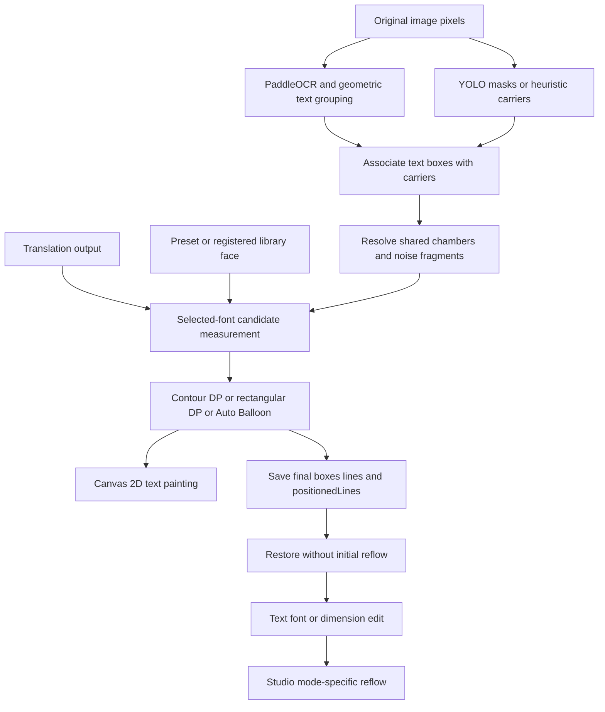

# Koharu and Kites Typesetting: Current Contract and Parity Assessment

**Reviewed:** 2026-10-29, source-port work on `fix/koharu-contour-source-parity`; donor revision `56787dc90606bd630ba7401441b32ab2f76afc18`.

**Purpose:** describe the shipped local implementation, its donor lineage, and remaining differences. “Exact” in a test filename or historical commit subject is not an acceptance result.

## 1. Status and scope

Kites ports contour-based line profiling, dynamic-programming line selection, reflex-neck decomposition, and anchor-based polygon partitioning from the local Koharu reference. It retains its own OCR grouping, YOLO/heuristic geometry acquisition, Canvas measurement/rasterization, free-text renderer, and Studio edit behavior.

Full end-to-end visual equivalence to Koharu or `pipelineVisualKoharuExactTest.ts` has **not been established**. Earlier claims of complete parity are superseded by this assessment. The browser investigation reproduced an application font-string bug and produced inspected images, but used different text, OCR output, style, and orchestration from the Node runner. A successful unit suite or browser script exit is not a pixel-parity gate.

See [Devlog 078](../dev-history/devlog/078_phase78_koharu_typesetting_visual_parity_browser_canvas_discrepancy.md), [font library specification](font_library_spec.md), and [testing guide](testing.md).

## 2. End-to-end mapping

### Detection and association

- Kites uses YOLO11n segmentation at 1024 square input or a heuristic pixel carrier extractor. These are not Koharu's detector/model.
- `NeuralBubbleDetector.matchBubbleIndex()` uses text-box intersection **coverage**, not intersection over union, with a default threshold of 0.50 and a center check. `BubbleLayoutService` uses the same coverage value for association.
- The inspected Koharu detection source uses foreground-mask containment with a threshold of 0.9 and chooses a containing bubble. This is not mathematically equivalent to box coverage.
- In neural mode an unmatched text region has no carrier. In heuristic mode the extractor attempts carrier discovery from original pixels. The active model setting does not guarantee that every visually enclosed text block receives an accepted layout.
- The mask curvature classifier's current rectangular threshold is `fillRatio >= 0.94`. It is a local heuristic, not semantic proof of a caption.

### OCR and grouping

Kites uses PaddleOCR line detection/recognition followed by geometric grouping and `utteranceSplitter.ts`. The donor pipeline can use different analysis entities and recognition models. Different blocks, anchors, noise fragments, or source-language filters can change shared-chamber partitioning before typesetting starts.

Do not attribute these differences to JavaScript integer arithmetic. Model outputs and preprocessing may differ across runtimes, but that requires measurement; the demonstrated font failure was invalid application syntax.

## 3. Geometry contracts

### Coordinate ownership

| Data | Coordinate space | Owner |
| --- | --- | --- |
| OCR polygons and boxes | Original image/page pixels | OCR service |
| `BubbleGeometry.contours` | Page-absolute vertices | `acquireBubbleGeometry()` |
| Accepted `typesetBoxes` | Page-absolute rectangles | Layout resolver |
| Resolved `contourPoints` | Relative to accepted box origin | Layout resolver |
| `positionedLines` | Local layout coordinates | Typesetter/render result |
| Studio contour | Relative to object frame | Restore/edit state |

The pipeline acceptance callback subtracts the candidate box origin from raw contour vertices. This keeps the contour and local text anchor in the same frame. `wrapTextContour()` also derives bounds from the supplied polygon, so absolute coordinates do not inherently mean zero intersections. Mixed frames can instead misplace anchors or downstream positions.

The resolver hands `accept()` the exact box-local polygon that assignment will store (`proposedContour`): a partition cell contour, a generated sub-chamber contour, or the translated chamber contour on the single-region path. Measuring a partitioned sibling against the whole shared chamber's wide chords rejects valid layouts at the explicit frame, so acceptance and assignment must never read different contour sources. The gate keeps the donor's best-effort semantics: an overflowing minimum-size layout is reported and rendered rather than rejected into the smaller auto-balloon fallback.

Grouping additionally treats two regions whose chamber contours occupy the same area (contour bbox IoU ≥ 0.7) as one shared chamber, covering engines that extracted the chamber but left carriers/proposals unlinked; `finalizeBubbleGeometry()` re-traces the chamber mask per region, so same-chamber utterances carry near-identical contours.

### Shared chambers

`resolveBubbleLayoutsDetailed()` groups common/nested/high-overlap carriers. It uses:

1. A single-region contour or computed typeset box, followed by pairwise clamping.
2. Rectangular/shared-container partitioning when all members are classified flat or no shared contour exists.
3. Reflex-neck decomposition, then contour-clipped anchor/Voronoi fallback for curved shared balloons.
4. A noise guard: if every secondary box has area at most 35% of the dominant box, the dominant takes the full shared contour and siblings become `skipped`. Substantial stacked siblings are not absorbed solely because they overlap horizontally.
5. Candidate acceptance and group collision rollback, followed by sibling boundary constraints.

The rectangular partition branch now supplies generated local sub-chamber polygons. These are synthetic geometry, not recovered mask boundaries. Contour point count alone does not establish whether a polygon is organic or synthetic.

Groups can still be rejected atomically. Rejected geometry is not universally recovered by a second heuristic pass. The pipeline's persistence code can fall back to raw analysis contours/carriers after detailed rejection; therefore saved editing metadata may differ from the strategy that painted the baked result. This is a known integration limitation, not guaranteed successful contour routing.

### Inpainting boundary

Bubble geometry affects layout, not erasure ownership. Inpainting remains polygon-only using original/raw OCR text polygons. Contours are not a blanket erase mask. Preserve the contract in ADR-002.

## 4. Typesetting algorithms and differences

### Contour DP

`contourTypeset.ts` is a compatibility facade; `utils/contour/` owns the portable horizontal layout core. `ContourDpTypesetter` and backend `SimpleRectTypesetter` compose that core. Studio simple edits retain their separate greedy/current-size behavior.

### Source mapping and port classification

| Responsibility | Pinned donor | Kites implementation | Evidence/qualification |
| --- | --- | --- | --- |
| Descending search and LastResort | `layout.rs:194–238`, `:387–435` | `contour/fontSearch.ts` | Source-derived tests for probes, floor buckets, clean preference, and recovery. |
| Profile/chord geometry | `layout.rs` profile and balloon helpers | `contour/profiles.ts`, `geometry.ts` | Five ink-band samples, common axis, 64-line cap, measured-ink air; injected-metric tests. |
| Profiled and uniform DP | `layout.rs:1411–1741` | `contour/lineBreaks.ts` | Overflow/line-count/cost ordering, cubic uniform fallback, f32 epsilon. |
| Tight ink bounds and placement | `layout.rs:744–893` | `contour/placement.ts` | PAD1, absolute baselines, full-frame fit; Canvas line bounds substitute for native per-glyph bounds. |
| Bounded hyphenation | `hypher 0.1.8` | `hyphenation/hypherTrie.ts`, lazy trie data | All 48 binary payloads copied exactly; source-derived multilingual vectors. |
| Line opportunities | ICU4X and Chinese word protection | `typography/contourSegments.ts`, `linebreak@1.1.0` | Same responsibility, not identical dependency: Unicode-13 UAX #14, approximate Korean KeepAll, no Chinese word dictionary. Injected opportunities bypass this adapter. |
| Font shaping and ink metrics | HarfRust/skrifa | Canvas `measureText` adapter | Explicit runtime difference; actual ink/font bounds provenance is reported. Width-only mocks are tagged fallback. |

Rust arithmetic is reproduced with focused `Math.fround` operations at layout boundaries. Native shaping/rasterization equality and live Rust differential execution have not been established. Rust/Cargo was not installed in the validation environment; TypeScript source-derived tests are not described as an executed Rust oracle.

### Current automatic contour policy

- Callers pass an explicit frame, and every production contour is already box-local (the geometry owner translates it), so the pure solver receives the frame directly. No hidden inset applies; the former whole-chamber inset adapter was removed once its callers moved to direct frames.
- Default minimum is 9 px; deliberate authored constraints remain explicit. Default descriptor line pitch is 1.2.
- Automatic horizontal maximum is the inset frame width. There is no implicit 48 px, word-count, width-percentage, or height-percentage cap in the contour route. Page-level XianScan harmonization applies only to free boxes.
- Font probes and selected sizes remain fractional. Search uses eight intervals, up to ten refinements, and 0.01 px tolerance.
- Search whole words first. Return early only when `floor(cleanSize) > floor(minimum)`; at the minimum bucket search LastResort and select it only if it gains a strictly larger floor bucket. At each candidate size LastResort still prefers a fitting clean layout.
- Kites extension on the contour route only (`sizingPolicy: 'fill'`, the `ContourDpTypesetter` and Studio contour default): compare the largest clean fit with the largest fit that allows discretionary breaks, and prefer the split when it exceeds the clean size by more than `CONTOUR_FILL_MIN_GAIN` (20% relative gain) plus `CONTOUR_FILL_EXTRA_CUT_PENALTY` (20%) for each discretionary cut beyond the first. This lets a single long word like "reinforcements" hyphenate far above the readability floor — it pays only the base threshold — while layouts that spray cuts across many words must earn proportionally more size and otherwise fall back to the smaller clean line. The donor policy remains the default of `wrapTextContour` itself and of Simple Rect; geometry, DP, placement, and the donor tail (uniform fallback at the floor) are unchanged. This is a deliberate divergence from the pinned renderer, not donor parity.
- Clearance is the maximum of configured minimum air and measured ink-band thickness. Candidate ordering compares overflow, line count, then cost for all candidates.
- Uniform fallback preserves multiple lines and reports overflow rather than fabricating one contained line. Tight ink dimensions plus one-pixel padding are checked against the frame.
- Contour eligibility uses five Unicode scalar characters in the alphabetic core and compact two-character fragment bounds. Donor hypher opportunities do not inherit the legacy seven-character English heuristic wrapper.
- Dictionary loading primes the independent legacy and contour resources without overwriting registered legacy patterns. Pre-load empty queries cannot remain cached after resources arrive.

The XianScan/Auto Balloon fitter and its four-pass policy remain separate. Shared cache correctness is not permission to change its break-selection policy.

### Strategy routing

Active canonical persisted/editing modes are `contour`, `balloon`, and `simple`. `ellipse` survives only as a legacy stored value normalized to `contour` during restore. A generated ellipse polygon is a geometry fallback, not a fourth engine.

- `contour`: contour DP, supplied polygon or a fallback shape.
- `balloon`: Auto Balloon, the Cotrans/XianScan-derived free-box route.
- `simple`: backend `SimpleRectTypesetter` runs contour DP on a rectangle; Studio simple edits instead use rectangular greedy wrapping at the current font size.

`TypesetStrategyFactory.resolve()` gives supplied contours priority for fixed layouts, even when a mode field says `simple`. This explains why a saved Caption Box label and a contour-shaped initial layout can coexist. `getByMode()` serves explicit strategy lookup; it is not interchangeable with inferred resolution.

See the [Auto Balloon](auto_balloon_typesetting_spec.md), [Simple Rect](simple_rect_typesetting_spec.md), and [renderer](cotrans_renderer_spec.md) specifications for route-specific behavior.

## 5. Font measurement and painting

The contour fitter previously wrapped a complete CSS stack in quotes. An already quoted stack then became invalid CSS, and Chrome retained its **previous** canvas font rather than adopting the requested probe size. Fresh contexts retained `10px sans-serif`; reused contexts could retain the preceding block's font. The drawing path used a valid stack, so the words painted at sizes unrelated to those measured. This accounts for state-dependent tiny and oversized text without invoking a browser arithmetic defect.

The fix preserves comma-separated stacks and quotes individual unquoted family names only when necessary. The same contract applies to Studio simple wrapping. The Node runner's former `CCWildWords, sans-serif` string was not the same as the quoted preset stack; enclosing it as a single family could silently select a fallback there too.

`PipelineOrchestrator` explicitly preloads selected family candidates and dictionaries before measurement. Studio keeps persisted lines on restore, then retries only tracked layouts generated while resources were pending; job switches, deletion, undo, and manual resize transactions are guarded. Resource readiness does not remap all stored objects. Font syntax, face availability, weight/style, and readiness remain separate requirements.

Koharu resolves font resources through its own native font system and shapes glyphs using its native stack. Kites uses FontFace/CSS and Canvas 2D. No per-family hardcoded geometry algorithm is justified by the reference investigation.

## 6. Persistence and Studio lifecycle

- The pipeline saves final renderer geometry, chosen font size, lines, spacing, colors, rotation, and positioned scanlines where available.
- Restore threads `contourPoints` and `positionedLines` into `TextObject`; existing measured lines are retained until a layout-affecting edit. Selection alone should not refit.
- `TextRenderer` paints Canvas 2D text from positioned lines when valid and compatible with styling; otherwise it uses its horizontal/vertical path. It is not an SVG text renderer.
- `CanvasFurniture` draws stored contour points with a white halo and blue dashed stroke regardless of mode, unless the object is skipped. A visible outline is evidence of stored geometry, not evidence of the chosen solver or text containment.
- Resize handles proportionally scale local contour points using a captured baseline and reflow during animation-frame updates. Other edit routes must not be assumed to share that scaling automatically.
- `originalContourPoints`, `detectedWidth`, and `detectedHeight` preserve an in-memory baseline. Restore initializes them from current persisted geometry; they are not independently saved original detections.
- Reset to Bubble Frame restores dimensions and contour only. It does not restore original page position or rotation, and the original detection baseline does not survive arbitrary save/reload as an independent record.
- Undo/redo stores object snapshots, so retained contour metadata travels with those snapshots. A complete transform/mode/save/reload acceptance matrix remains required before claiming donor lifecycle parity.
- Mode-only changes preserve current lines and define future edit intent. Switching away from contour is not proof that original geometry has been deleted; switching back is not a new detection pass.

Koharu distinguishes the original automatic analysis region from authored geometry. Its overlay can show the original automatic region while a custom geometry is transformed. Its transient drag transform and committed re-layout are not identical to Kites' current live reflow/overlay behavior.

## 7. Validation and diagnostics

### Why the Node runner is not an end-to-end oracle

`pipelineVisualKoharuExactTest.ts` uses hardcoded semantic transcription, native OCR/inference, a directly registered reference font, bold drawing, and manually constructed neural mask evidence. It does not instantiate `PipelineOrchestrator`, and still differs from full production orchestration. Its acceptance callback now passes frame-local contour metadata and it writes per-block JSON with actual strategy, frame, lines, sizes, and placements. It does not exercise Chrome's font setter, background state normalization, database restore, Studio font switching, undo, or export.

`chromeBubbleProbe.mjs` drives Studio OCR, not a live-web bake; its returned inpainted patch is not a rendered English Studio canvas. The standalone Chrome bake harness uses a temporary exposed orchestrator in an extension page, seeds model cache, and prints blocks. It currently calls the orchestrator directly, not the addressed `PROCESS_JOB` path, and has no automated image-diff assertion. Browser execution success is not visual acceptance.

### Diagnostic order

1. Confirm requested and resulting `ctx.font` at multiple probe sizes in the actual context.
2. Confirm face bytes, selected family, bold/italic, and readiness agree between measurement and painting.
3. Hold translated text, source language, OCR boxes, masks, and styles constant across runtimes.
4. Compare accepted/rejected box, partition cell, contour origin, mode, and skip status per region.
5. Inspect `positionedLines` and final painted bounds, not just `fontSize`.
6. Test initial Studio restore separately from edits, transforms, mode switches, reset, undo/redo, save/reload, and export.

## 8. Module ownership and retained history

- `engines/typeset/`: strategy interface/factory and three concrete strategies.
- `utils/contourTypeset.ts`: compatibility exports; `utils/contour/`: portable profiles, segments, DP, font policy, geometry, measurement adaptation, and placement.
- `utils/typography/`: shared tokenization, kinsoku rules, and marker-aware unwrapping.
- `utils/geometry/`: polygon math, neck decomposition, partitioning, sibling clearance.
- `services/BubbleLayoutService.ts`: association, geometry resolution, noise suppression, acceptance/rollback.
- `utils/cotransDefaultRenderer.ts` and `utils/renderer/`: strategy dispatch, Canvas painting, line-break/region helpers.
- `studio/canvas/`: object edits, transforms, text painting, and selection furniture.

The retired `renderer/cotransTextRasterizer.ts` is no longer an active module. Historical devlogs 072–077 preserve implementation milestones; their exact-parity wording is historical, not stronger evidence than this current assessment.
