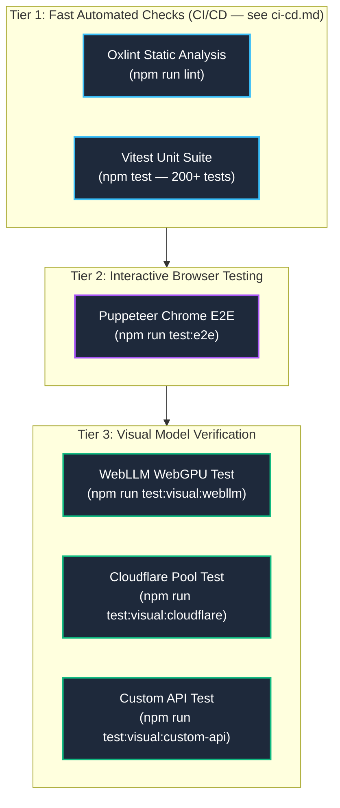

# Testing & Verification Guide 🧪

Kites enforces a strict multi-tier testing strategy to ensure that background workers, neural models, spatial clustering algorithms, and browser overlays remain robust across Chromium releases.

---

## 🏗️ Testing Strategy Overview



---

## ⚡ Tier 1: Automated Unit Tests (`npm test`)

Unit tests run via **Vitest** under `src/`. The local-main merge check on 2026-10-28 reported 104 files / 1,122 passing tests; duration depends on hardware and parallel workers. These checks do not establish visual parity:

```bash
npm test
```

### What is tested:
- **Backend Orchestrators:** Translation waterfall failover logic, circuit breaking, token-bucket rate limiting, and Delimiter formatting (`TranslationManager.test.ts`).
- **Spatial Clustering Math:** Kruskal's MST algorithm, Euclidean distance thresholds, direction majority scoring, and convex hull overlap logic.
- **Typesetting Heuristics:** 4-pass font fitting bounds, hyphenation triggers, tall-box aspect ratio clamping, and decollision matrix math. CJK token segmentation in Pass 1 prevents whole-sentence word width inflation and 14px collapse; soft line-break hyphens rejoin during reflow without stripping intentional compound hyphens (`typesetLayout.test.ts`, `studioTypeset.test.ts`, `persistedTextObjects.test.ts`).
- **Studio Upload and Layout Persistence:** Atomic page/job persistence, acknowledged background queue routing, serialized website/upload processing, and restoration of final renderer boxes, lines, direction, rotation, and baseline spacing. `studioUpload.test.ts`, `queueResilience.test.ts`, `PipelineOrchestrator.test.ts`, `canvasTypesetting.test.ts`, and `persistedTextObjects.test.ts` cover these boundaries. Sticker upload remains a separate layer action; the editor's **Upload & translate page** action shares the Library entry point.
- **Studio Layout Ownership:** Initial pipeline lines remain unchanged under either editing mode. Mode selection and unchanged inline editing do not fit again; actual text/font/dimension edits use the selected existing engine. `studioTypeset.test.ts`, `TypographySettings.test.tsx`, `StudioCanvas.test.tsx`, `Studio.layout.test.tsx`, `offscreenStudioBridge.test.ts`, and `FindReplaceModal.test.tsx` cover initial preparation, global/local mode scope, edit routing, and paint-only rendering.
- **Database & Queue Lifecycle:** Dexie.js IndexedDB schema migrations, orphan job cleanup, and configurable history retention (1 day, 1 week, 1 month, or Never). Cleanup excludes active jobs and skips deletion when settings cannot be read.
- **Chapter ZIP Export:** Page-scoped reading order, detached-image retention, ZIP contents, size limits, partial failures, and duplicate-export protection (`chapterZip.test.ts`).
- **Translation Glossary:** Bounded dictionary normalization, per-request terminology snapshots, prompt data boundaries, and forwarding through the translation waterfall (`glossary.test.ts`, `BaseLlmTranslationEngine.test.ts`, `TranslationManager.test.ts`).
- **Reading Shortcuts:** Editable-field and modifier guards, original/translated toggling, and top-frame command routing (`readingShortcuts.test.ts`, `readingCommands.test.ts`).

### Source-port contour validation

The `utils/contour/` suites test pinned donor search/policy, profiled/uniform DP, f32 boundaries, ink placement, and honest overflow. `typography/contourSegments.test.ts` and `HyphenationService.test.ts` include source-derived hypher vectors and readiness/cache isolation. Studio generation/readiness tests guard cancellation, manual resize, undo, deletion, and resource-wait edits. These are source-derived TypeScript checks; no live Rust oracle has been executed in the current host environment.

`npm run test:visual:koharu` remains separate. It renders `src/test/result/pipeline_bubble_neural/image6_koharu_exact.png` and writes a JSON sidecar with source/font hashes and each block's actual strategy and output. The transcription uses `UNDERSTOOD!` without pre-inserted hyphens. Several regions can still fall back to Auto Balloon after geometry rejection; inspect the sidecar before attributing every visible hyphen to contour DP. A clean runner exit is not full-page visual parity, and original ink/inpainting artifacts are outside the pure solver proof.

Use the supported `npm test` command. Bare `npx vitest run` also discovers archived engines under `archive/`; those preserved tests refer to removed dependencies and old import paths and are not part of the active source suite.

---

## 🌐 Tier 2: Interactive End-to-End Tests (`npm run test:e2e`)

To verify real extension integration in a real Chromium browser instance:

```bash
# Ensure extension is built first
npm run build

# Run interactive Puppeteer browser test
npm run test:e2e
```

### What this test verifies:
1. Launches a visible Chromium instance with `dist/` loaded as an unpacked extension.
2. Visits a test page containing manga images.
3. Simulates user hover and triggers the translation button.
4. Verifies message passing between Content Script $\to$ Service Worker $\to$ Offscreen Runtime.
5. Verifies the original `` is successfully replaced with a translated Blob URL without SPA reversion.

---

## 🎨 Tier 3: Real-Model Visual Verification (Manual Visual Gate)

> **Rule:** Real-model visual tests remain separate from `npm test`. Requirements vary: native Node ONNX runners can run on CPU; browser neural tests may need WebGPU/model caches; cloud/custom API runners require appropriate credentials. The pipeline smoke workflow runs selected checks, but does not supply an automatic visual-acceptance gate. Do not infer image quality from a successful exit.

To run end-to-end visual tests with real models:

### 1. WebLLM Local WebGPU Pipeline
```bash
npm run test:visual:webllm
```
- Tests on-device WebLLM inference using `@mlc-ai/web-llm` and local ONNX PaddleOCR.
- Outputs rendered images to `result/pipeline_webllm/` for manual visual inspection.

### 2. Cloudflare Shared Pool Pipeline
```bash
npm run test:visual:cloudflare
```
- Exercises the authenticated Cloudflare Worker backend and multi-model waterfall.

### 3. Custom API Pipeline (BYOK)
```bash
npm run test:visual:custom-api
```
- Tests user-supplied OpenAI, Gemini, or Anthropic API endpoints.

---

## Contour and font regression evidence

```bash
# Native reference runner; hardcoded transcription, not the production orchestrator
npm run test:visual:koharu

# Real-browser diagnostic scripts; build first
npm run build
node scripts/chromeBubbleProbe.mjs --bubbles-only
node scripts/e2eChromeBakeVisualTest.mjs
```

The Node runner uses native inference/canvas, manually builds neural evidence, directly registers a reference font, and hardcodes translated text. It can reveal layout regressions but does not cover Chrome CSS parsing, popup hydration, Studio edits, or addressed extension messaging.

The bubble probe drives Studio OCR. Its saved patch is an inpaint/background response, not proof of rendered translated text. The bake harness seeds local YOLO model bytes and directly calls an exposed orchestrator in an extension page. It prints blocks and writes `src/test/result/e2e_chrome_baked_wildwords.png`; it currently has no image-diff assertions and does not exercise the complete content-script or Studio interaction path. Temporary browser profiles do not share IndexedDB across separate launches.

Before claiming equivalence:

1. Hold input pixels, transcription, OCR boxes, contour geometry, source/target language, face bytes, weight/style, and layout options constant.
2. Verify the resulting `ctx.font`, not only the requested string, at different probe sizes. Invalid CSS assignments keep the previous font. Test a fresh context and a context reused after another block.
3. Confirm fonts are loaded in the actual measuring/painting document before fitting. A hash check or `font-display: block` alone is insufficient.
4. Compare font size, lines, positioned coordinates, route, accepted/rejected geometry, and skip flags. Then open and inspect the rendered output; preserve comparable artifacts with settings/revision metadata.
5. Separately exercise Studio initial-open preservation, font changes, resize/move/rotation, local/global mode switches, reset, undo/redo, save/reload, and export.

The 2026-10-28 investigation reproduced and repaired font syntax, but did not complete this controlled matrix. See [Devlog 078](../dev-history/devlog/078_phase78_koharu_typesetting_visual_parity_browser_canvas_discrepancy.md). Neither 1,122 passing unit tests nor a screenshot with different words proves exact parity.

## 🔍 Code Linting & Static Checks

```bash
npm run lint
```
Runs **Oxlint** across all TypeScript source files to catch unused variables, missing hook dependencies, and syntax anomalies.
